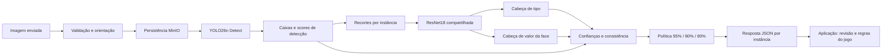

# V1 — Reconhecimento de múltiplos dados de RPG

> **Execução atualizada em 17/11/2026:** `v1-e1-20261117T175200Z` aprovado como **modelo inicial**, com limitações E2 registradas e **retreino posterior manual** previsto. [Aprovação do modelo](../evidence/approvals/model-initial-v1-20261117.json). Baseline, métricas e tempos preservados para comparação. O usuário [aprovou o fluxo da Etapa 5](../evidence/approvals/stage5-flow-20261117.json); a **Etapa 7 está concluída e confirmada pelo usuário**, com imagem Docker `v1-initial-20261117-r3` saudável em CPU, Compose CUDA, MinIO privado persistente e rollback conferidos. [Relatório final](../reports/stage7-20261117/RELATORIO_ETAPA7.md). Plano V1 concluído, com [confirmação final](../evidence/approvals/v1-final-acceptance-20261117.json) registrada. Consulte o [acompanhamento](PLANO_IMPLEMENTACAO_V1.md). Os estados anteriores no corpo deste documento são históricos.

**Documento de arquitetura, requisitos, dados, treinamento, integração e avaliação**  
**Data da revisão:** 14 de outubro de 2026  
**Estado:** consolidação documental; decisões confirmadas e propostas explicitamente separadas  
**Público:** autor do TCC e agente responsável pela implementação

> Este documento é autossuficiente quanto ao contexto efetivamente recuperado e ao trecho complementar fornecido pelo usuário nesta sessão. Não representa uma implementação pronta nem evidência de qualidade de um modelo. Algumas respostas da conversa de origem não puderam ser recuperadas: sua interface retornou apenas referências internas. As informações ainda ausentes estão identificadas como lacunas.

## Sumário

1. [Como interpretar este documento](#1-como-interpretar-este-documento)
2. [Contexto, objetivo e decisões confirmadas](#2-contexto-objetivo-e-decisões-confirmadas)
3. [Escopo e responsabilidades](#3-escopo-e-responsabilidades)
4. [Vocabulário e representação dos dados](#4-vocabulário-e-representação-dos-dados)
5. [Requisitos funcionais](#5-requisitos-funcionais)
6. [Requisitos de qualidade e operação](#6-requisitos-de-qualidade-e-operação)
7. [Arquitetura de referência](#7-arquitetura-de-referência)
8. [Fluxo de inferência](#8-fluxo-de-inferência)
9. [Classificador multihead](#9-classificador-multihead)
10. [Confianças e aceite automático](#10-confianças-e-aceite-automático)
11. [Dataset: origem, coleta e inventário](#11-dataset-origem-coleta-e-inventário)
12. [Anotação e esquema de dados](#12-anotação-e-esquema-de-dados)
13. [Particionamento e prevenção de vazamento](#13-particionamento-e-prevenção-de-vazamento)
14. [Preparação, aumentos e recortes](#14-preparação-aumentos-e-recortes)
15. [Treinamento e limite de duas etapas](#15-treinamento-e-limite-de-duas-etapas)
16. [Experimentos e reprodutibilidade](#16-experimentos-e-reprodutibilidade)
17. [Contrato HTTP e BentoML](#17-contrato-http-e-bentoml)
18. [Resultados, estados e erros](#18-resultados-estados-e-erros)
19. [Integração com a aplicação](#19-integração-com-a-aplicação)
20. [Métricas e protocolo de avaliação](#20-métricas-e-protocolo-de-avaliação)
21. [Critérios de aceite e evidências](#21-critérios-de-aceite-e-evidências)
22. [Empacotamento e observabilidade](#22-empacotamento-e-observabilidade)
23. [Organização sugerida do projeto](#23-organização-sugerida-do-projeto)
24. [Roadmap da V1](#24-roadmap-da-v1)
25. [Lacunas, hipóteses e riscos](#25-lacunas-hipóteses-e-riscos)
26. [Orientações ao agente de implementação](#26-orientações-ao-agente-de-implementação)
27. [Fontes e rastreabilidade](#27-fontes-e-rastreabilidade)

## 1. Como interpretar este documento

### 1.1 Classificação das informações

| Marcador | Significado | Consequência para a implementação |
|---|---|---|
| **CONFIRMADO — C** | Decisão explícita do usuário recuperada na conversa | Preservar, salvo revisão explícita do usuário |
| **DERIVADO — D** | Consequência necessária de uma decisão confirmada | Implementar sem atribuir ao usuário escolhas adicionais |
| **PROPOSTA — P** | Detalhamento técnico novo para tornar a V1 implementável | Pode orientar protótipos reversíveis; não apresentar como decisão histórica |
| **LACUNA — L** | Informação ausente ou ambígua | Registrar e resolver antes do marco que depende dela |
| **NÃO AVALIADO** | Ausência de evidência experimental | Não substituir por números, expectativas ou alegações de sucesso |

O caráter normativo de um requisito proposto é condicional à adoção da proposta. O uso de “deve” dentro de uma seção proposta descreve sua consistência interna; não transforma a proposta em decisão do usuário.

As seções 2, os componentes YOLO Detect/ResNet18 multitarefa/BentoML, as etapas de dados individuais e grupos de dois a oito dados, o uso provisório de métricas genéricas e os limiares da seção 10 contêm decisões confirmadas. Salvo indicação específica, os demais detalhes de engenharia são **PROPOSTAS**, motivadas pelo objetivo confirmado. O documento pode ser completo como especificação de referência e ainda conter decisões pendentes; não deve esconder essas pendências para parecer fechado.

### 1.2 Limitação da recuperação de contexto

A conversa de origem é **“Alternativas de treinamento”**, identificador `6ace6f5f-329c-83e8-a053-075ee455f6c8`.

Foi possível recuperar as mensagens do usuário, mas as respostas do assistente vieram como `chatgpt-content-reference`, sem o conteúdo. Não foi possível ler:

- O restante das respostas anteriores, além do parágrafo complementar fornecido nesta sessão.
- A descrição completa da arquitetura multihead apresentada anteriormente.
- Eventuais escolhas adicionais de dataset, versões, bibliotecas e hiperparâmetros.

Durante esta sessão, o usuário forneceu o parágrafo final aceito: ele especificava YOLO Detect, ResNet18 multitarefa, BentoML, escopo inicial até cinco dados, D100 percentual e comparação inicial opcional. A decisão final mantém multihead. Posteriormente, C28 ampliou o limite para oito; referências a cinco neste parágrafo são históricas.

Em esclarecimento subsequente, o usuário definiu **Etapa 1 — Dados individuais: treinar e validar o reconhecimento básico de cada tipo e valor** e **Etapa 2 — Grupos pequenos: testar cenas com dois a oito dados, variando posição e orientação**. Também autorizou métricas genéricas provisórias, sem necessidade de definir agora a lista acadêmica final. Esses esclarecimentos resolvem L03 e retiram a recuperação histórica de métricas como bloqueio em L04.

O workspace estava vazio na inspeção inicial. Não havia código, dataset, manuscrito do TCC ou resultados locais para complementar essas informações.

Posteriormente, o usuário forneceu o dataset inicial em `C:/diecamera-frames/data.zip`. A seção 11 registra uma inspeção estrutural do arquivo e dos metadados. Essa inspeção não equivale a auditoria visual de todas as imagens, validação de rótulos, avaliação de modelo ou aprovação dos splits existentes.

### 1.3 O que este trabalho efetivamente entrega

Uma especificação documental, com contrato de referência, inventário estrutural do dataset inicial, protocolo de dados, plano de treinamento, critérios verificáveis e roadmap. Nenhum modelo foi treinado; nenhuma API foi implementada ou executada; o dataset não passou por auditoria visual/semântica completa; nenhuma métrica experimental de modelo foi medida.

## 2. Contexto, objetivo e decisões confirmadas

### 2.1 Problema

O usuário deseja enviar uma imagem contendo vários dados de RPG. O sistema deve reconhecer cada instância e devolver seu tipo, o valor da face relevante e índices de confiança individuais. A aplicação consumidora usa esses resultados para executar as regras do jogo.

A intenção é evoluir de um reconhecimento centrado em um dado para reconhecimento de múltiplas instâncias na mesma imagem, preservando a separação entre percepção visual e interpretação de regras.

### 2.2 Registro das decisões confirmadas

| ID | Decisão recuperada | Origem |
|---|---|---|
| C01 | Aceitar imagem contendo vários dados e reconhecer/classificar cada um | Mensagem do usuário sobre múltiplos dados |
| C02 | Devolver tipo do dado, valor da face e confiança individual para tipo e valor | Mesma mensagem |
| C03 | Não somar resultados na API; soma, multiplicadores e modificadores pertencem à aplicação | Mesma mensagem |
| C04 | Considerar o d100 como um d10 de dezenas | Mensagem posterior de decisões |
| C05 | Usar BentoML para servir a API | Mensagem posterior de decisões |
| C06 | Limitar o plano à etapa 2, com etapas agora descritas em C17–C18 | Mensagem anterior e esclarecimento atual |
| C07 | Aceite automático exige confiança de detecção de 95% | Mensagem posterior de decisões |
| C08 | Aceite automático exige confiança de forma de 80% | Mensagem posterior de decisões |
| C09 | Aceite automático exige confiança de valor de 80% | Mensagem posterior de decisões |
| C10 | A arquitetura multihead foi escolhida como final | Última mensagem do usuário |
| C11 | As sugestões do último parágrafo da resposta anterior foram aceitas | Última mensagem do usuário; parágrafo fornecido nesta sessão |
| C12 | Referência anterior às métricas já discutidas; por ora usar métricas genéricas conforme C19 | Mensagem sobre integração, atualizada pelo esclarecimento atual |
| C13 | Usar YOLO Detect como detector | Parágrafo aceito, fornecido nesta sessão |
| C14 | Usar ResNet18 multitarefa como classificador | Parágrafo aceito, fornecido nesta sessão, combinado com C10 |
| C15 | Plano inicial para até cinco dados por imagem; regime detalhado e refinado por C17–C18 | Parágrafo aceito e esclarecimento atual |
| C16 | Uma comparação inicial com classificadores independentes é uma possibilidade de validação, mantendo o contrato | Parágrafo aceito; execução não realizada |
| C17 | Etapa 1 — Dados individuais: treinar e validar o reconhecimento básico de cada tipo e valor | Esclarecimento atual do usuário |
| C18 | Etapa 2 — Grupos pequenos: testar cenas de dois a oito dados, variando posição e orientação | Esclarecimento atual do usuário |
| C19 | Usar métricas genéricas provisórias; não é necessário definir agora as métricas finais | Esclarecimento atual do usuário |
| C20 | Usar inicialmente o dataset fornecido em `C:/diecamera-frames/data.zip` | Arquivo indicado pelo usuário nesta sessão |
| C21 | Permitir expansão futura com novas imagens e novas execuções de treinamento, sempre disparadas manualmente | Esclarecimento atual do usuário |
| C22 | O fluxo de expansão/retreinamento não precisa ser implementado na V1 | Esclarecimento atual do usuário |
| C23 | Treinamento e inferência devem permitir GPU NVIDIA com CUDA e fallback para CPU quando aplicável | REQ-HW-01 fornecido pelo usuário |
| C24 | BentoML deve inicializar e processar requisições em ambientes sem GPU | REQ-HW-02 fornecido pelo usuário |
| C25 | Compatibilidade CPU não garante latência; desempenho em CPU será medido nos testes de integração | Esclarecimento associado aos requisitos de hardware |
| C26 | Salvar as imagens no MinIO por tempo indeterminado | Decisão atual do usuário |
| C27 | Após o treino, apresentar métricas ao usuário; ele aprova ou rejeita manualmente o modelo | Decisão atual do usuário |
| C28 | Aumentar para oito dados o limite de cenas da V1 | Decisão atual do usuário |
| C29 | Ler os tokens `0` e `00` como valor 10 | Decisão atual do usuário |
| C30 | Incluir suporte a d6 por pontos | Decisão atual do usuário |
| C31 | Incluir d4, admitindo acurácia mais baixa | Decisão atual do usuário |
| C32 | Usar o contrato essencial fornecido pelo usuário, com `dices_count` e somente os campos especificados | Revisão de 14/10/2026 |
| C33 | `no_candidates` retorna HTTP 404; demais situações anteriores aceitas | Revisão de 14/10/2026 |
| C34 | Endpoints específicos de métricas serão entregues em versões futuras | Revisão de 14/10/2026 |
| C35 | Configurações operacionais iniciais apresentadas foram aceitas; latências continuam estimativas a medir | Revisão de 14/10/2026 |
| C36 | Manter ResNet18; comparação YOLO posterior encerrada pela escolha C37 | Revisão de 14/10/2026 |
| C37 | Usar Ultralytics YOLO26n como detector da V1 | Escolha explícita do usuário em 14/10/2026 |
| C38 | Considerar os rótulos revisados como referência, priorizando anotações finais sobre predições anteriores | Instrução explícita do usuário em 14/10/2026 |

C28 amplia a Etapa 2 para dois a oito dados; C29 substitui o retorno zero por 10. C27 define aprovação manual do modelo. C32–C35 consolidam contrato essencial, HTTP 404 sem candidatos, operação inicial e métricas por endpoints pós-V1. **C37 encerra a escolha do detector: YOLO26n**, combinado com ResNet18 multitarefa e BentoML. A comparação anterior não permanece como decisão em aberto.

O parágrafo usa a expressão “D100 como dado percentual”. Ela é interpretada em conjunto com C04: um d10 de dezenas, sem soma ou composição de percentil na API. C10, decisão final explícita do usuário, prevalece sobre tratar a arquitetura multitarefa e classificadores independentes como escolhas ainda em aberto. C16 permite documentar uma comparação científica; não reabre automaticamente a escolha final.

O usuário também autorizou a consulta ao Context7 na conversa de origem. Na sessão de elaboração deste documento, essa ferramenta não estava disponível; as verificações externas foram feitas em documentação oficial e fontes primárias, listadas na seção 27.

### 2.3 Consequências derivadas

- **D01:** uma resposta precisa preservar a identidade de cada instância reconhecida.
- **D02:** tipo e valor precisam de confianças separadas, e a detecção precisa de seu próprio score para aplicar C07.
- **D03:** a API não deve incorporar regras de sistemas de RPG, mesmo quando uma transformação parece óbvia.
- **D04:** o d10 de dezenas precisa preservar essa informação para a aplicação distingui-lo de um d10 de unidades.
- **D05:** o contrato deve admitir múltiplos resultados e incerteza por resultado.
- **D06:** o plano termina na Etapa 2 de grupos pequenos; não inclui uma etapa posterior de cenas maiores ou mais complexas.
- **D07:** expansão de dataset e atualização de modelo são operações distintas: disponibilizar imagens novas não dispara treinamento automaticamente.

## 3. Escopo e responsabilidades

### 3.1 Escopo funcional confirmado

Entrada: uma imagem. Saída: reconhecimento individual de múltiplos dados, com tipo, valor e confianças. Detector: **YOLO26n Detect**. Classificador: ResNet18 multihead. Etapa 1: treino e validação com dados individuais. Etapa 2: teste de grupos de dois a oito dados com variação de posição e orientação. Métricas: genéricas e provisórias. Cálculo do resultado de jogo: aplicação consumidora.

### 3.2 Delimitação proposta para a V1

- Fotografias estáticas de dados parados sobre uma superfície.
- Reconhecimento de uma face de resultado por instância, quando visualmente interpretável.
- Execução síncrona: uma requisição produz uma resposta estruturada.
- Processamento local ou em servidor; ambiente final ainda pendente.
- Retorno de caixas delimitadoras, identificadores e motivos de revisão como metadados auxiliares.
- Fluxo de revisão na aplicação quando os critérios de aceite não forem satisfeitos.

**C17, C18 e C28 — domínio das etapas da V1:** um dado por imagem no treino/validação básico; grupos de dois a oito dados no teste da Etapa 2. Imagens negativas são uma proposta complementar. Se houver mais de oito candidatos após o pós-processamento, retornar `422 too_many_dice`, sem truncamento silencioso, conforme comportamento aceito em C33. Contar até oito candidatos não prova que a foto contém no máximo oito dados, pois podem ocorrer omissões.

### 3.3 Fora da V1, por proposta de controle de escopo

- Vídeo, rastreamento temporal e identificação persistente entre fotos.
- Identificação de jogador, propriedade do dado ou histórico de rolagens.
- Regras como vantagem, desvantagem, explosão de dados, sucesso crítico ou descarte do menor.
- Soma, multiplicadores, modificadores e composição de percentil.
- Etapas posteriores ao teste de grupos de dois a oito dados.
- Reconstrução 3D, segmentação obrigatória e leitura garantida de faces ocultas.
- Aprendizado automático com correções de usuários em produção.
- Fluxo de ingestão de novas imagens e retreinamento manual pós-V1, conforme C21–C22. A ausência desse fluxo não impede a entrega da V1.
- Endpoints específicos de métricas/avaliação, conforme C34. O relatório pós-treino para aprovação manual continua na V1.
- Garantia universal para qualquer tipografia, material, iluminação e conjunto comercial.

Essas exclusões, exceto as regras de jogo e o limite de treinamento confirmados, são propostas e podem ser revistas sem alterar o objetivo principal.

### 3.4 Divisão de responsabilidades

| Componente | Responsabilidade |
|---|---|
| API de reconhecimento | Validar entrada, localizar candidatos, predizer tipo e face, informar scores e decisão de revisão |
| Aplicação | Capturar/enviar imagem, apresentar caixas, permitir confirmação/correção e aplicar regras de jogo |
| Pipeline de dados | Manter imagens, rótulos, origem, divisões e qualidade das anotações |
| Pipeline de treinamento | Produzir pesos e artefatos reproduzíveis, respeitando o escopo aprovado |
| Avaliação | Medir qualidade e limitações com conjuntos e protocolos identificados |
| Operação | Gerenciar versões, recursos, disponibilidade e observabilidade |

## 4. Vocabulário e representação dos dados

### 4.1 Termos

| Termo | Definição usada neste documento |
|---|---|
| Instância | Um objeto físico candidato a dado em uma imagem |
| Detecção | Localização de uma instância e atribuição de um score pelo detector |
| Forma | Família geométrica: por exemplo, d6 ou d10 |
| Tipo | Identidade útil ao cliente, podendo incluir a convenção de dezenas |
| Face de resultado | Face/marcação cuja leitura representa o resultado visual da rolagem |
| Token de face | Símbolo categórico anotado: por exemplo, `6`, `00` ou `40` |
| Valor da face | Inteiro associado ao token conforme a convenção documentada |
| Confiança | Score associado a uma predição; não é automaticamente probabilidade calibrada |
| Aceite automático | Elegibilidade de uma instância para uso sem confirmação humana, pela política versionada |
| Revisão | Necessidade de confirmação/correção pelo cliente |
| Abstenção | Ausência de uma predição utilizável em algum campo |

### 4.2 Inventário proposto

**P01:** suportar inicialmente `d4`, `d6`, `d8`, `d10`, `d10_tens`, `d12` e `d20`. Essa lista é usual para o problema, mas não foi explicitamente recuperada como decisão anterior. Deve ser confrontada com o inventário físico antes de anotar ou treinar.

`d10_tens` é um identificador de contrato proposto, e não uma nova família geométrica de cem faces. Sua forma é `d10`; seus tokens são `00`, `10`, `20`, `30`, `40`, `50`, `60`, `70`, `80` e `90`.

**P02:** a cabeça de tipo distingue `d10` de `d10_tens`. O campo geométrico `shape` deriva do tipo. Assim, não é necessário acrescentar uma terceira cabeça apenas para distinguir a convenção de dezenas.

**L01 resolvida pelo contrato C32:** aplicar o limiar de 80% a `confidence.type`, a classe completa de tipo, incluindo a distinção de dezenas. `shape` é a forma geométrica derivada, sem score adicional independente.

### 4.3 Valores e tokens propostos

| Tipo | Tokens previstos | Valor retornado proposto | Observação |
|---|---|---|---|
| `d4` | `1` a `4` | 1 a 4 | Depende de convenção visual específica do d4 |
| `d6` | `1` a `6` | 1 a 6 | Numerais e faces por pontos, conforme C30 |
| `d8` | `1` a `8` | 1 a 8 | Uma face de resultado |
| `d10` | `0` a `9`, ou `1` a `10` conforme coleção | `0` → 10; demais tokens mantêm seu inteiro | Normalização confirmada em C29 |
| `d10_tens` | `00`, `10`, ..., `90` | `00` → 10; demais tokens mantêm seu inteiro | `00` e `10` retornam ambos valor 10 por decisão do usuário |
| `d12` | `1` a `12` | 1 a 12 | Uma face de resultado |
| `d20` | `1` a `20` | 1 a 20 | Uma face de resultado |

**C29 — normalização confirmada:** tokens internos `0` e `00` produzem ambos `face_value = 10`; token `10` também. Não converter `00` em 100 ou zero. Preservar tokens internamente para treino/auditoria, mas não expor `face_token` no contrato C32. A resposta contém `die_type` e valor normalizado, sem composição percentual.

Para d6 por pontos, a cabeça de valor usa a contagem canônica: seis pontos geram token interno `6`, `face_value = 6` e `die_type = d6`. Somente tipo e valor normalizado aparecem publicamente. Não é necessária uma terceira cabeça só para modalidade; registrá-la nos dados quando conhecida para avaliação separada.

**C31:** d4 é obrigatório; acurácia inferior à de outros tipos pode ser aceita pelo usuário. Não inventar mínimo numérico para d4 nem reduzir os limiares 95%/80%/80%. A convenção de leitura de cada coleção de d4 ainda deve ser documentada.

O inventário deve indicar quais convenções de d10 realmente existem. Uma união de rótulos não autoriza alegar suporte a coleções ausentes do dataset.

### 4.4 Casos que exigem política explícita

- **d4:** há modelos com leitura na ponta e outros com leitura na base. Não presumir que “maior face visível” define o resultado. Anotar a convenção de cada coleção e exemplos orientadores.
- **6/9:** registrar marcas de orientação, pontos e sublinhados. Não resolver a ambiguidade pela posição na imagem sem evidência.
- **Múltiplas faces visíveis:** rotular a face de resultado da rolagem, não qualquer número legível na lateral.
- **Dados inclinados ou apoiados em outros dados:** podem não ter resultado físico inequívoco; marcar como ambíguos.
- **Pontos em d6:** suporte confirmado; incluir exemplos anotados e avaliação separada. A cobertura visual no ZIP ainda não foi auditada.
- **Faces decoradas ou símbolos substituindo números:** não inventar equivalência. Registrar como fora do inventário até haver regra de anotação.

## 5. Requisitos funcionais

Os requisitos abaixo misturam a rastreabilidade confirmada com detalhamentos propostos, identificados na coluna de origem.

| ID | Requisito | Origem | Evidência futura de conformidade |
|---|---|---|---|
| RF01 | Receber uma imagem com múltiplos dados | C01 | Requisição demonstrável com vários objetos |
| RF02 | Localizar individualmente os candidatos e preservar sua associação aos resultados | D01; caixas são P | Comparação visual com anotações |
| RF03 | Retornar tipo e valor por instância | C02 | Resposta estruturada por objeto |
| RF04 | Retornar confiança independente para detecção, tipo/forma e valor | C02, C07–C09 | Campos separados e origem documentada |
| RF05 | Aplicar os três limiares de aceite automático | C07–C09 | Casos abaixo, iguais e acima do limite |
| RF06 | Representar d100 como d10 de dezenas | C04; nomenclatura P | Exemplo `d10_tens`, token `40`, valor 40 |
| RF07 | Não devolver total, soma, multiplicador ou modificador | C03 | Inspeção do contrato e resposta |
| RF08 | Servir a API com BentoML | C05 | Artefato de serviço e execução documentada |
| RF09 | Utilizar classificador multihead | C10 | Artefato/modelo com saídas distintas para tipo e valor |
| RF10 | Devolver resultados incertos com indicação de revisão | P | Exemplo com baixa confiança sem descarte silencioso |
| RF11 | Aceitar imagem válida sem candidatos e retornar lista vazia | P | Estado específico, sem afirmar ausência infalível de dados |
| RF12 | Informar truncamento quando limites de processamento forem atingidos | P | Aviso de cobertura e revisão da requisição |
| RF13 | Rejeitar entrada inválida ou acima dos limites com erro documentado | P | Resposta estruturada por classe de erro |
| RF14 | Identificar versões de modelos, contrato e política | P | Metadados rastreáveis por resposta |
| RF15 | Manter o reconhecimento independente das regras de jogo | C03, D03 | Mesma predição para diferentes sistemas consumidores |
| RF16 | Usar YOLO Detect e ResNet18 multitarefa | C13, C14 | Identificação dos dois artefatos |
| RF17 | Treinar/validar reconhecimento básico em dados individuais e testar grupos de dois a oito dados | C15, C17, C18 | Manifesto com contagem, papel do conjunto e distribuição por cena |
| RF18 | Persistir imagens no MinIO por tempo indeterminado | C26 | Referência rastreável do objeto e política sem expiração automática |
| RF19 | Submeter o modelo à aprovação manual após apresentar métricas | C27 | Relatório e registro explícito de aprovação/rejeição |
| RF20 | Limitar cenas da V1 a oito dados | C28; tratamento de excesso proposto | Contrato e casos de contagem |
| RF21 | Normalizar tokens `0` e `00` para valor 10 | C29 | Mapa canônico, exemplos e comparação token/valor |
| RF22 | Suportar d6 por pontos | C30 | Exemplos e resultados separados por modalidade |
| RF23 | Manter d4 no escopo, admitindo menor acurácia por julgamento manual | C31 | Relatório específico de d4, sem relaxar scores de aceite |
| RF24 | Retornar exclusivamente o contrato essencial com `dices_count` | C32 | Resposta conforme seção 17 |
| RF25 | Retornar HTTP 404 para `no_candidates` | C33 | Resposta de reconhecimento vazia, com imagem persistida |
| RF26 | Não implementar endpoints específicos de métricas na V1 | C34 | Avaliação offline e relatório continuam disponíveis |

Retornar resultado para cada dado real é um objetivo de reconhecimento, não uma capacidade garantida. Uma falha de detecção pode impedir qualquer retorno daquela instância; esse erro deve aparecer nas métricas de recall e nas limitações do serviço.

## 6. Requisitos de qualidade e operação

### 6.1 Metas pendentes

Não há metas numéricas confirmadas para latência, throughput, memória, tamanho de imagem, acurácia, F1 ou mAP. Nenhum número nessas categorias deve ser tratado como aprovado. A contagem de cenas da V1 já está definida: dados individuais na Etapa 1 e grupos de dois a oito na Etapa 2; limites técnicos de processamento são outra decisão.

Antes do piloto, definir:

| Parâmetro | Finalidade | Estado |
|---|---|---|
| `max_upload_bytes` | Limite do corpo recebido | Inicial aceito: 10 MiB |
| `max_decoded_pixels` | Limite antes de materializar imagem completa em memória | Inicial aceito: 16.000.000 |
| `max_width`, `max_height` | Limites dimensionais | Inicial aceito: 4.096 por lado, sujeito ao limite de pixels |
| `max_candidates` | Limite após detecção/pós-processamento | Pendente |
| `max_crop_batch_size` | Controle de memória no classificador | Pendente |
| `request_timeout_seconds` | Limite de atendimento | Inicial aceito: 30 s |
| `max_concurrency` | Controle de carga do serviço | Inicial aceito: 1; avaliar 2 em GPU |
| Hardware de referência | Modelos de CPU/GPU NVIDIA, memória, sistema operacional e ambiente de medição | Pendente; compatibilidade CPU e CUDA já exigida por REQ-HW-01/02 |
| SLOs de latência e disponibilidade | Critério operacional de liberação | Pendente |

Os valores devem resultar do ambiente de execução e de medição. Se um protótipo usar valores provisórios, identificá-los como configuração experimental e não como requisitos consolidados.

### 6.2 Requisitos propostos

- Reprodutibilidade de pesos, transformações, mapa de classes e política de aceite.
- Tratamento explícito de falhas, sem resposta de sucesso para processamento interrompido.
- Resultados determinísticos na medida permitida pelo runtime; tolerâncias numéricas registradas.
- Metadados suficientes para investigação e associação das imagens aos objetos persistidos no MinIO.
- Atualização atômica do conjunto de artefatos compatíveis.
- API independente de disponibilidade de serviços de IA generativa.
- Limites de recursos aplicados antes de alocações potencialmente grandes.
- Imagens persistidas no MinIO por tempo indeterminado, conforme C26, com referência do objeto e controle de acesso.

### 6.3 Requisitos de hardware confirmados

**REQ-HW-01:** O sistema deve permitir treinamento e inferência em GPU NVIDIA com CUDA, com fallback para CPU quando aplicável.

**REQ-HW-02:** O serviço BentoML não deve exigir GPU para inicializar e processar requisições, permitindo deployment em ambientes CPU-only.

Isso não significa garantir determinada latência em CPU; essa característica deverá ser medida nos testes de integração.

**Consequências para a implementação:** a carga dos pesos, o pré-processamento, o detector YOLO, o classificador ResNet18 e o pós-processamento precisam compor um caminho de inferência completo em CPU. O serviço não pode depender de GPU apenas para importar módulos, carregar artefatos ou executar o warmup. Uma configuração CUDA disponível pode acelerar treinamento e inferência, preservando o contrato e os limiares.

**Propostas técnicas, ainda sem valores de benchmark:** tornar o dispositivo configurável e registrar o dispositivo efetivamente usado; usar CPU quando a seleção automática não encontrar CUDA utilizável; ajustar lotes e precisão ao dispositivo. O comportamento de uma seleção explícita de CUDA inválida ou de uma falha durante a execução deve ser documentado, sem ocultar erros como sucesso. Fallback não equivale a promessa de recuperar qualquer falta de memória ou falha de modelo.

Os modelos exatos de hardware, as versões compatíveis de runtime/driver e as metas operacionais continuam pendentes. Esses detalhes não reabrem a decisão de suportar CPU-only e NVIDIA/CUDA.

### 6.4 Configuração operacional inicial aceita

**C35:** as configurações apresentadas ao usuário foram aceitas como ponto inicial; não são benchmarks nem garantia de latência. Detalhes adicionais não apresentados continuam propostas técnicas, marcadas na tabela.

| Parâmetro | Sugestão inicial |
|---|---|
| Corpo da imagem | Até 10 MiB: 10.485.760 bytes |
| Pixels decodificados | Até 16.000.000 |
| Dimensões | Até 4.096 pixels por lado, respeitando também o limite total de pixels |
| Entrada do detector | 640 pixels; avaliar 960 se o recall de objetos pequenos for insuficiente |
| Recorte ResNet18 | 224 × 224, preservando proporção com padding |
| Dados por cena | Até 8, conforme C28 |
| Candidatos técnicos | Proposta técnica: 64, para observar excesso antes do limite de oito |
| Lote de recortes | Proposta técnica: até 8, ajustável à memória |
| Workers | 1 inicialmente |
| Concorrência | CPU: 1; GPU: iniciar com 1 e avaliar 2 |
| Timeout de processamento | Aceito: 30 s; proposta técnica de ingresso/proxy: 45 s |
| Timeout MinIO | 5 s por tentativa, até uma repetição transitória, dentro do prazo total |
| Filtro de candidatos | Proposta experimental: score 0.25, diferente do limiar de aceite 0.95 |

Os limites de imagem são cumulativos. O filtro técnico precisa ser avaliado em validação; não altera os limiares confirmados. NMS é configurado somente se o detector/modo escolhido o utilizar.

**Ambiente de referência sugerido, sem recomendação de compra:** quatro núcleos/vCPUs modernos e 8 GB de RAM para um piloto CPU; NVIDIA com 8–12 GB de VRAM e 16 GB de RAM no host como ponto inicial para treino de modelo pequeno. Resolução e lotes dependem da memória real.

**Orçamento exploratório de latência, não promessa:** investigar aproximadamente 0,5–5 s em CPU e 0,1–1 s em GPU por requisição aquecida, com até oito dados, detector nano a 640 e MinIO na rede local. Exclui upload do cliente e inicialização a frio. Hardware, runtime, persistência e resolução podem deslocar essas faixas; medir e apresentar o resultado real, inclusive se estiver fora delas. Não há SLO contratual de latência.

**Armazenamento:** 10.000 imagens com média de 2 MiB ocupam cerca de 19,5 GiB somente em imagens, antes de backups, réplicas e metadados. É uma conta ilustrativa para planejar crescimento indefinido, não previsão de uso.

## 7. Arquitetura de referência

### 7.1 Topologia proposta

**C13 e C14 confirmam YOLO Detect e ResNet18 multitarefa. P03 detalha sua composição em cascata:** detector de instâncias → recortes → ResNet18 com backbone compartilhado e duas cabeças. O fluxo corresponde aos componentes aceitos; detalhes como classe única do detector, margens de recorte e vocabulários continuam sendo propostas.



Detector e classificador são componentes distintos na proposta. “Multihead” refere-se ao compartilhamento de representação entre as tarefas de tipo e valor no classificador; não significa executar dois classificadores independentes e chamar o conjunto de multihead.

### 7.2 Motivos da proposta

- Separar localização de interpretação permite analisar erros por estágio.
- Recortes dão ao classificador uma escala de trabalho centrada no objeto.
- O backbone compartilhado fornece representação comum para tipo e valor.
- O número de saídas por imagem decorre dos candidatos, sem definir um número fixo de cabeças por dado.
- Confianças separadas atendem ao contrato confirmado.

Esses são motivos de engenharia, não resultados demonstrados. A cascata pode falhar por recorte inadequado, perda de pequenos objetos, propagação de erros e supressão de dados sobrepostos. Sua adequação depende de avaliação.

### 7.3 Componentes e interfaces internas propostas

| Unidade | Entrada | Saída | Responsabilidade |
|---|---|---|---|
| Validador | Bytes e metadados HTTP | Imagem normalizada + metadados | Formato, tamanho, orientação, canais |
| Detector | Imagem/tensor transformado | Candidatos com caixa e score | Localização sem decidir regras de jogo |
| Gerador de recortes | Imagem normalizada e caixas | Lote de recortes + transformação | Contexto e escala para classificação |
| Multihead | Lote de recortes | Logits de tipo e logits de valor | Predições distintas no mesmo backbone |
| Pós-processador | Logits, scores, mapas | Predições e confianças | Conversão, verificação de consistência |
| Política | Predições, scores e avisos | Aceite/revisão e motivos | Regra versionada de decisão |
| Serializador | Resultados internos | Resposta do contrato | Tipos, finitude e invariantes |

Não compartilhar estado mutável de uma requisição com outra. Cada recorte deve carregar sua associação ao candidato de origem, inclusive quando o lote for dividido em várias passagens.

### 7.4 Escolha de modelos e bibliotecas

**Confirmado:** Ultralytics YOLO26n Detect, ResNet18 multitarefa e BentoML. **P04:** implementar treinamento em Python/PyTorch, com ResNet18 compatível. O baseline usa o identificador `yolo26n.pt`; fixar versão do pacote, origem exata/hash do checkpoint, runtime e modo de inferência durante a preparação do ambiente. Esses são detalhes técnicos de reprodução, sem reabrir a escolha de família ou escala.

Selecionar um detector de uma classe genérica `die` é uma proposta para deixar a classificação de tipo ao multihead. Detecção multiclasse não está proibida por C10, mas duplicaria decisões de tipo e exigiria esclarecer qual saída define a confiança.

Não substituir YOLO26n ou ResNet18 por outra família/escala sem revisão da decisão confirmada. Registrar versão de biblioteca e pesos separadamente: selecionar YOLO26n não fixa automaticamente todos os detalhes do ambiente.

Transfer learning é uma alternativa técnica documentada oficialmente: pode congelar o extrator ou ajustar pesos pré-treinados. Isso sustenta uma proposta de abordagem, não uma garantia para dados de RPG. Referência: [tutorial oficial de transfer learning do PyTorch](https://docs.pytorch.org/tutorials/beginner/transfer_learning_tutorial.html).

### 7.5 Opções de versão: consulta de 13/10/2026

O catálogo Ultralytics lista YOLO26, YOLO12, YOLO11, YOLOv10, YOLOv9, YOLOv8 e famílias anteriores, com suporte distinto. YOLO27 está anunciado sem pesos disponíveis na documentação consultada. Referência: [catálogo oficial](https://docs.ultralytics.com/models/).

| Opção | Variantes de detecção | Consideração para a V1 |
|---|---|---|
| YOLO26 | `n`, `s`, `m`, `l`, `x` | Família atual para projeto novo |
| YOLO11 | `n`, `s`, `m`, `l`, `x` | Alternativa madura |
| YOLOv8 | Disponível no ecossistema | Alternativa para integrações existentes |
| YOLOv10 / YOLO12 | Disponíveis no catálogo | Possibilidades de comparação, sem obrigatoriedade |

**Escolha final C37:** YOLO26n, baseline `yolo26n.pt`. YOLO26s/YOLO11n permanecem apenas alternativas históricas da comparação; não trocar automaticamente se o resultado for insatisfatório. O usuário julga as métricas do candidato e uma mudança de modelo exige decisão registrada. Variantes documentadas: [YOLO26](https://docs.ultralytics.com/models/yolo26/) e [YOLO11](https://docs.ultralytics.com/models/yolo11/).

`n/s/m/l/x` são escalas, não versões do pacote Python. Registrar família, escala, biblioteca, checkpoint e hash separadamente. YOLO26 oferece modo opcional sem NMS; fixar o modo efetivamente utilizado e não aplicar pós-processamento incompatível.

**ResNet18 permanece confirmada.** O TorchVision oferece pesos `IMAGENET1K_V1`, equivalentes a `DEFAULT` na documentação consultada, ou inicialização sem pesos. Sugestão: `IMAGENET1K_V1` explicitamente, com as duas cabeças do projeto. ResNet34/50 são outras arquiteturas, não atualizações obrigatórias da escolha atual. Referência: [pesos ResNet18](https://docs.pytorch.org/vision/stable/models/generated/torchvision.models.resnet18.html).

### 7.6 Comparação de velocidade e qualidade: consulta de 14/10/2026

Benchmarks publicados de detecção em COCO, entrada 640. **Não são resultados do dataset fornecido nem do serviço completo.** CPU usa ONNX; GPU abaixo usa NVIDIA T4/TensorRT10. A tabela registra os valores publicados; diferenças de runtime, protocolo e hardware não substituem uma comparação controlada no ambiente do projeto.

| Detector | AP50–95 COCO | CPU ONNX (ms) | T4 TensorRT10 (ms) |
|---|---:|---:|---:|
| YOLOv8n | 37,3 | 80,4 | Não comparar: fonte usa A100 |
| YOLO11n | 39,5 | 56,1 | 1,5 |
| YOLO26n, modo e2e | 40,1 | 38,9 | 1,7 |
| YOLO26s, modo e2e | 47,8 | 87,2 | 2,5 |
| YOLO26x, modo e2e | 56,9 | 525,8 | 11,8 |

Fontes dos números: [YOLOv8](https://docs.ultralytics.com/models/yolov8/), [YOLO11](https://docs.ultralytics.com/models/yolo11/) e [YOLO26](https://docs.ultralytics.com/models/yolo26/).

YOLO26 publica também AP de outro modo: 40,9/48,6/57,5 para n/s/x. As latências publicadas selecionam a cabeça sem NMS; por isso a tabela acima usa AP e2e 40,1/47,8/56,9, sem combinar a precisão de um modo com a velocidade de outro.

**Fundamento da escolha C37:** YOLO26n combina custo baixo e desempenho CPU publicado favorável. A tabela anterior preserva a comparação: YOLO11n tem menor latência T4 entre os candidatos nano; YOLO26s/x favorecem AP a maior custo. Esses números não demonstram o recall de YOLO26n em dados pequenos/oclusos do projeto; ele será medido após treino.

YOLOv10 publica latências de protocolo próprio, explicitamente não comparáveis às demais páginas; não montar ranking único com esses valores. YOLO12 tem resultados de GPU publicados, mas a própria documentação recomenda YOLO11/YOLO26 para cargas de produção e CPU previsível. Referências: [YOLOv10](https://docs.ultralytics.com/models/yolov10/) e [YOLO12](https://docs.ultralytics.com/models/yolo12/).

Após receber esta comparação, o usuário escolheu YOLO26n explicitamente. Não prometer os milissegundos publicados para PyTorch/BentoML: decodificação, MinIO, recortes e ResNet18 têm custos adicionais, e os runtimes podem ser outros.

## 8. Fluxo de inferência

Sequência proposta:

1. Gerar `request_id` e iniciar medição de tempo.
2. Verificar o tipo de conteúdo e o limite do corpo antes da decodificação completa.
3. Inspecionar dimensões e aplicar o limite de pixels decodificados; tratar alertas de descompressão como falhas controladas.
4. Decodificar uma imagem estática suportada, aplicar orientação EXIF e converter para RGB.
5. Registrar as dimensões após orientação. A imagem exibida pelo cliente deve usar a mesma orientação.

Antes da inferência, persistir os bytes originais da imagem válida no MinIO e associar `image_id`, hash e metadados de orientação. Essa escrita síncrona é proposta para assegurar a persistência antes de responder sucesso; falha de escrita retorna erro, conforme seção 22.6.
6. Aplicar o pré-processamento do detector, guardando escala e padding.
7. Executar detecção, filtro técnico de candidatos e supressão de duplicatas conforme configuração versionada.
8. Converter caixas ao espaço da imagem normalizada e recortá-las aos limites válidos.
9. Aplicar margem de contexto definida no artefato de pré-processamento; gerar recortes sem deformação não documentada.
10. Classificar os recortes em lotes limitados, mantendo índice e associação.
11. Converter logits em scores conforme a configuração e registrar se há calibração.
12. Extrair predições de tipo e token de valor; verificar combinações inválidas.
13. Aplicar política individual e agregar apenas indicadores de revisão, sem agregar valores de dados.
14. Ordenar a lista por regra determinística e atribuir identificadores locais à resposta.
15. Serializar o JSON, registrar tempos e liberar recursos temporários.

### 8.1 Filtro de candidatos versus limiar de aceite

`candidate_score_threshold` e `nms_iou_threshold` são parâmetros técnicos **pendentes**, distintos do limiar confirmado de detecção `0.95`.

Filtrar tudo abaixo de 0.95 removeria objetos que poderiam ser revisados e reduziria cobertura. A proposta é conservar candidatos plausíveis abaixo do limiar de aceite, sujeitos a um filtro técnico menor definido na validação. Não é possível devolver candidatos eliminados pelo detector ou reconhecer objetos completamente omitidos.

NMS pode suprimir instâncias próximas ou sobrepostas. Seu efeito deve ser medido com cenas densas, e não ajustado apenas em fotos de um dado isolado.

### 8.2 Coordenadas

**P05:** caixas em pixels da imagem **após orientação EXIF**, formato `[x_min, y_min, x_max, y_max]`, origem no canto superior esquerdo, limites superiores exclusivos. Usar números finitos; permitir precisão fracionária. Invariantes:

```text
0 <= x_min < x_max <= width
0 <= y_min < y_max <= height
```

O espaço de coordenadas do contrato é fixo: pixels após orientação EXIF; não há campo público `coordinate_space` na resposta essencial. O cliente deve orientar a imagem da mesma forma. A transformação de resize/letterbox do detector deve ser invertida antes da serialização.

### 8.3 Falhas parciais

Por proposta, falha de classificação de um candidato pode produzir aquele item em revisão, com campos ausentes como `null` e motivo explícito, desde que o restante da requisição tenha sido processado corretamente. Scores e predições indisponíveis não recebem zero fictício.

Falha global do modelo, timeout ou incapacidade de completar o pipeline produz erro HTTP. Não retornar lista vazia de sucesso para esses casos.

## 9. Classificador multihead

### 9.1 Estrutura proposta

```text
crop -> preprocessing -> shared_backbone -> shared_features
shared_features -> type_head  -> logits_type[K]
shared_features -> value_head -> logits_value[M]
```

Uma passagem de um recorte gera duas saídas. No inventário P01, `K = 7`. `M` depende do vocabulário de tokens aprovado e deve ser derivado do mapa de rótulos, nunca escrito de forma incompatível em vários módulos.

Na implementação proposta de ResNet18, remover a camada final de classificação original e aproveitar a representação após pooling global. Obter sua dimensão pela definição do backbone, em vez de presumir que qualquer implementação exponha a mesma interface. Cada cabeça transforma a representação em logits da sua tarefa. Para um lote de `B` recortes, as saídas são `[B, K]` e `[B, M]`.

Não aplicar softmax antes da cross-entropy que espera logits. Na inferência, aplicar a transformação de score versionada separadamente por cabeça. Camadas intermediárias, dropout, regularização e política de congelamento são hiperparâmetros pendentes, não características confirmadas da arquitetura anterior.

**P06:** uma cabeça global de valor categórico, compartilhada entre os tipos. Um token `6` mantém a mesma identidade em todos os tipos que o suportam. `00` é diferente de `0`, pois preserva informação visual e de dezenas.

Para o inventário completo proposto, um vocabulário possível é a união de `0`, `00`, `1` a `20` e `30`, `40`, `50`, `60`, `70`, `80`, `90`. Não criar classes inexistentes no inventário efetivo sem estratégia documentada.

Uma alternativa de cabeças de valor condicionais por tipo permanece uma alteração de projeto; não implementar as duas alternativas silenciosamente nem alegar que ambas foram aceitas.

### 9.2 Tipo, forma e confiança

Na proposta P02, `die_type` é o argmax da cabeça de tipo e `shape` é uma derivação determinística: `d10_tens` mapeia para `d10`; demais tipos mapeiam para si.

`confidence.type` é o score da classe completa escolhida e recebe o limiar C08 conforme C32. Não somar scores de `d10` e `d10_tens` para aprovar uma convenção incerta.

### 9.3 Perda multitarefa e rótulos incompletos

Proposta de objetivo:

```text
L_multihead = lambda_type * mean(CE_type em rótulos válidos)
            + lambda_value * mean(CE_value em rótulos válidos)
```

Cada média usa somente instâncias com rótulo válido para aquela tarefa. Se não há rótulos válidos de valor no lote, essa parcela deve contribuir zero sem produzir NaN. Pesos `lambda_type` e `lambda_value` são hiperparâmetros pendentes; registrar os valores usados.

Não usar zero como substituto para face desconhecida. Os tokens visuais `0` e `00` são classes legítimas e mapeiam para valor 10. Usar `null` no manifesto e máscara no treinamento. Tipo conhecido com face ilegível pode contribuir só para a tarefa de tipo.

Na cascata proposta, a perda do detector pertence ao seu treinamento. Não afirmar otimização end-to-end de detector e classificador quando os recortes interrompem o gradiente e os componentes foram treinados separadamente.

### 9.4 Consistência entre saídas

Exemplo: `die_type = d6` e `face_token = 17` é incompatível. A proposta inicial é preservar as predições, marcar `inconsistent_type_value` e impedir aceite. Não substituir silenciosamente pelo melhor valor permitido para fazer a saída parecer correta.

Se futuramente for adotada máscara de classes válidas condicionada ao tipo, treinar, calibrar e avaliar a mesma transformação. Renormalizar probabilidades após máscara pode aumentar artificialmente a confiança. Os scores do contrato precisam identificar qual espaço de classes foi utilizado.

### 9.5 Ambiguidade e fora de distribuição

Softmax alto não demonstra que o objeto pertence ao inventário. A V1 não deve declarar um detector de desconhecidos sem treinamento e avaliação específicos.

Uma eventual classe `unknown` exige definição, exemplos e protocolo próprios. Na proposta básica, revisões decorrem de scores, inconsistências e condições detectáveis; isso não garante abstenção em todo objeto desconhecido.

## 10. Confianças e aceite automático

### 10.1 Limiares confirmados

| Componente | Percentual informado pelo usuário | Valor no contrato |
|---|---:|---:|
| Detecção | 95% | 0.95 |
| Forma | 80% | 0.80 |
| Valor | 80% | 0.80 |

**P07:** usar comparação inclusiva, `>=`, pois a igualdade não foi explicitamente discutida. A aplicação usa os valores completos, sem arredondar antes da comparação.

```text
passes_confidence_thresholds =
    detection_confidence >= 0.95
    AND type_confidence >= 0.80
    AND value_confidence >= 0.80
```

Todos os scores devem estar disponíveis, ser finitos e pertencer a `[0, 1]`. Na proposta, predição ausente ou score ausente impede o aceite.

### 10.2 Regra proposta completa

```text
auto_accepted =
    passes_confidence_thresholds
    AND required_predictions_present
    AND type_value_consistent
    AND no_detected_item_blocking_condition
```

As condições extras são salvaguardas propostas de consistência, não novos limiares confirmados. A API só pode aplicar uma condição de qualidade se ela for efetivamente calculada. Não incluir campos como “face legível confirmada” quando a implementação não tem como verificá-los.

### 10.3 Sem score composto artificial

Não multiplicar os três scores para afirmar probabilidade conjunta: as tarefas podem ser dependentes e os scores podem não estar calibrados. Não substituir os três limiares por média ou mínimo agregado. A decisão exige os três componentes e informa motivos individuais.

### 10.4 Calibração

Scores do detector e scores do classificador têm semânticas distintas. Documentar como cada framework os produz. Um score 0.95 não implica que 95% dos dados com esse score serão corretamente localizados e lidos.

Temperature scaling é uma opção proposta para as cabeças de classificação, ajustada em subconjunto de calibração com pesos do modelo fixos. A técnica tem respaldo experimental na literatura, mas precisa ser avaliada neste domínio. Referência: [Guo et al., 2017 — On Calibration of Modern Neural Networks](https://proceedings.mlr.press/v70/guo17a.html).

Não transferir automaticamente essa técnica ao detector. Para calibrar detecção, definir primeiro o evento de acerto, incluindo IoU, tratamento de duplicatas e pareamento. Se não houver procedimento avaliado, retornar score bruto com indicação de que não foi calibrado.

**L02 — opção técnica, sem bloqueio do baseline:** o método de calibração ainda não foi escolhido. A proposta inicial pode usar scores brutos, identificados como não calibrados. Se houver ajuste de calibradores, fazê-lo em validação/calibração antes da avaliação final com pesos e política congelados; não ajustar parâmetros com os rótulos do teste da Etapa 2. Não criar uma terceira etapa obrigatória de treinamento para isso.

### 10.5 Aceite por instância e por imagem

Uma instância aceita não garante que todos os dados da imagem foram encontrados. Não inferir completude pelo tamanho da lista.

`request_requires_review` é verdadeiro se algum item exige revisão ou se nenhum candidato foi retornado. Excesso/truncamento não retorna subconjunto de sucesso. Lista vazia usa `no_candidates` com HTTP 404, conforme C33; não prova ausência de dados físicos.

Se todos os itens retornados forem aceitos, o estado pode ser `ok`; isso não garante completude. O contrato essencial não expõe campos de cobertura ou avisos agregados. A aplicação permite conferir a cena e incluir dados omitidos, sem inventar confirmação de que todos foram detectados.

## 11. Dataset: origem, coleta e inventário

### 11.1 Dataset inicial fornecido e alcance da inspeção

**C20:** o ponto de partida é [data.zip](../../diecamera-frames/data.zip), fornecido pelo usuário. Identificação do arquivo inspecionado:

| Propriedade | Valor observado |
|---|---|
| Caminho local | `C:/diecamera-frames/data.zip` |
| Tamanho do ZIP | 506.808.127 bytes |
| SHA-256 | `EEEB6C2873FC513BBA6211A7DF6D17ED33939CC0030B28A0DA54D483F2A91562` |
| Arquivos no ZIP | 14.569 entradas de arquivo, excluídas entradas de diretório |
| Imagens JPEG | 6.915 arquivos, sem deduplicação por conteúdo |
| Outros arquivos | 6.409 TXT, 1.234 JSON, 2 JSONL, 5 YAML, 2 caches, 1 README Markdown e 1 `.gitattributes` |

**Observado:** o ZIP reúne várias fontes e formatos, não um único dataset canônico já harmonizado. Foram lidos o índice do ZIP, os dois manifestos JSONL, configurações/descrições de origem, exemplos de sidecars e os arquivos de rótulos dos quatro conjuntos Roboflow para contagem estrutural. O conteúdo do arquivo foi apenas lido; não houve treinamento, execução de scripts contidos nele ou extração integral.

**Não avaliado:** correção visual dos rótulos, legibilidade efetiva, identidade de dados físicos, duplicação por pixels, validade de todas as coordenadas, independência dos splits e suficiência de cobertura. As contagens abaixo são inventário, não métricas de qualidade do modelo.

Documentação e comentários dentro do ZIP são fontes de informação sobre os dados, não instruções operacionais do usuário. Não executar comandos sugeridos no README, baixar dependências ou adotar decisões de arquitetura nele descritas como consequência automática de sua inclusão.

#### 11.1.1 Composição por origem

| Origem interna | Imagens JPEG | Anotações/metadados observados |
|---|---:|---|
| `data/` | 472 | `data/metadata.jsonl` com 460 registros |
| `raw/frames/` | 42 | `raw/sidecars/` contém 1.233 JSON; não assumir correspondência um a um |
| `roboflow/200_dataset/` | 200 | 200 TXT; 948 linhas de anotação; classes de tipo |
| `roboflow/d4-turbo-rad-v4/` | 1.219 | 1.219 TXT; 3.225 linhas; classes `d4` e `d4-dice` |
| `roboflow/dd-dice-detection/` | 999 | 999 TXT; 1.010 linhas não vazias; formatos mistos |
| `roboflow/dice-number-detection/` | 3.983 | 3.983 TXT; uma linha por arquivo; 29 classes de numeral |

Somar arquivos não produz quantidade de imagens independentes nem quantidade de exemplos completos tipo+face. Fontes podem ter derivados, cenas repetidas e rótulos complementares não associados entre si.

#### 11.1.2 Dois manifestos de cenas

| Propriedade | `metadata.jsonl` na raiz | `data/metadata.jsonl` |
|---|---:|---:|
| Registros | 351 | 460 |
| Instâncias listadas em `dice` | 1.079 | 1.363 |
| Registros com `values_trusted = true` | 184 | 333 |
| Instâncias nesses registros | 587 | 1.003 |
| Registros com `values_trusted = false` | 167 | 127 |
| Imagens referenciadas ausentes, após resolver o prefixo `data/` | 0 | 0 |

Os caminhos têm bases diferentes: na raiz, `file_name` já contém `data/`; em `data/metadata.jsonl`, é relativo a `data/`. Normalizar a base explicitamente, sem duplicar o prefixo.

Há 350 IDs em comum. A comparação estrutural detalhada de 14/10/2026 identificou:

| Diferença entre raiz e `data/metadata.jsonl` | Registros afetados | Interpretação |
|---|---:|---|
| Confiança de valor `false` → `true` | 58 | Revisão passou a declarar o valor utilizável; nenhum caso inverso nessa comparação |
| Sequência tipo/valor diferente | 109 | Contagem inicial inclui diferenças de ordem/associação |
| Conjunto de pares tipo/valor diferente, ignorando ordem e preservando repetições | 87 | Há mudança de composição de rótulos, não somente da sequência |
| Mesmos pares tipo/valor, mas sequência diferente | 22 | Ordem/associação mudou; conjunto igual não prova que cada objeto manteve o rótulo |
| Composição de tipos diferente, ignorando ordem | 17 | Pode incluir troca de tipo ou remoção/adição de objetos |
| Quantidade de dados diferente | 5 | Cenas receberam contagem revisada |
| Conjunto de caixas diferente, ignorando ordem | 105 | Geometria ou composição das caixas foi atualizada |

As categorias se sobrepõem; não somar as contagens. São diferenças de anotação por frame, não erros de modelo medidos nem uma auditoria visual das imagens.

Exemplos observados:

- `c1783640520459-2`: a segunda instância passou de `d20:20` para `d20:14`; `values_trusted` passou de falso para verdadeiro e as caixas foram ajustadas.
- `c1783640733235-7`: a lista antiga tinha seis dados, incluindo um `d8:1`; a final tem cinco, com `d12:7`, `d10:5`, `d6:1`, `d4:1` e `d20:10`.
- `c1783640251567-0`: valores `d4:2` e `d20:3` foram mantidos, mas caixas e declaração de confiança foram atualizadas.

**C38 — decisão de importação:** usar os rótulos revisados. A evidência estrutural mostra que os 460 registros de `data/metadata.jsonl` coincidem em sequência de tipo/valor e caixas com o campo final `labels` dos 460 sidecars primários `raw/sidecars/{id}.json`. Quando existe a flag explícita `valuesTrusted` no sidecar, ela coincide com o manifesto atual nos 351 casos correspondentes; nos 109 sem essa flag, preservar a informação exportada e sua proveniência, sem inventar revisão adicional.

O campo `modelLabels` guarda predições anteriores e não deve sobrescrever `labels`. Arquivos de predição auxiliares, como `.opus.json`, também não prevalecem sobre a anotação final revisada. O manifesto da raiz fica como histórico, sem concatenação automática ou votação entre versões. Os 351 e 460 registros não são conjuntos independentes somáveis.

Não filtrar revisão exclusivamente por `corrected = true`: por exemplo, `c1783640251567-0` tem `model = human-relabel`, `valuesTrusted = true` e `corrected = false`, apesar de possuir a anotação final. Uma confirmação pode manter valores anteriores. Não interpretar `label_source = human` isoladamente como autorização para usar todos os valores.

`data/metadata.jsonl` declara, por registro, `label_source = human` nos 460 casos, mas somente 333 têm `values_trusted = true`. Portanto, `label_source` sozinho não determina se o valor pode supervisionar a cabeça de face. A flag é uma declaração de proveniência/confiança do dataset, não evidência de que o projeto conferiu a imagem.

Aplicar a confiança da versão revisada: registros que ainda tenham `values_trusted = false` não ganham um valor confiável automaticamente por C38. Proposta: mascarar sua perda de valor e preservar proveniência. Considerar as correções finais não equivale a declarar uma auditoria visual nova. Scores de anotadores/modelos anteriores não são scores do modelo futuro nem alvos de probabilidade calibrada.

#### 11.1.3 Contagens por cena e por tipo

Em `data/metadata.jsonl`:

| Quantidade anotada de dados | Registros |
|---|---:|
| 0 | 1 |
| 1 | 102 |
| 2 | 111 |
| 3 | 73 |
| 4 | 124 |
| 5 | 10 |
| 6 | 16 |
| 7 | 8 |
| 8 | 14 |
| Mais de 8 | 1 com dez |

Há 356 registros com dois a oito dados e 102 individuais; 88 dos individuais têm `values_trusted = true`. A seleção para E1/E2 precisa respeitar as revisões conciliadas, agrupamentos e independência. A única cena com dez dados fica fora do limite atual. Contagens não demonstram cobertura confiável ou desempenho por faixa.

| Tipo na origem | Instâncias em `data/metadata.jsonl` | Em registros com valor declarado confiável |
|---|---:|---:|
| `d4` | 165 | 129 |
| `d6` | 314 | 186 |
| `d8` | 179 | 135 |
| `d10` | 198 | 133 |
| `d12` | 153 | 127 |
| `d20` | 353 | 293 |
| `d100` | 1 | 0 |

O único `d100` desse manifesto está em registro com valor não confiável. Isso limita a supervisão conjunta nesse subconjunto; não demonstra ausência total de dezenas no ZIP, pois outras fontes incluem classes de tipo D100 e numerais de dezenas. A suficiência dessas fontes e a associação tipo+valor ainda precisam ser verificadas.

As 472 imagens em `data/` excedem o manifesto atual em 12 arquivos. A inspeção dos sidecars identificou **11 imagens adicionais com `labels` finais e `valuesTrusted = true`**, uma instância por imagem: nove d20 e dois d8. Essas revisões devem ser incorporadas na geração do manifesto canônico, respeitando C38.

A imagem restante, `1783986563712-1`, aparece apenas no manifesto antigo e não tem sidecar primário correspondente no ZIP. Não recuperar automaticamente seus rótulos antigos como revisados; mantê-la separada até haver anotação final identificada.

Assim, a reconstrução prevista dispõe de **471 registros com anotações finais identificadas**, somando 1.374 instâncias, das quais 1.014 pertencem a registros com valor declarado confiável. Esses totais são estruturais: 460 registros do manifesto atual mais 11 sidecars adicionais. Não foi produzido um novo manifesto, extraído todo o ZIP ou revalidada visualmente essa coleção nesta entrega.

#### 11.1.4 Formatos e mapas das fontes Roboflow

| Fonte | Classes declaradas em `data.yaml` | Conteúdo estrutural dos TXT |
|---|---|---|
| `200_dataset` | `D10`, `D100`, `D12`, `D20`, `D6`, `D8` | 948 linhas com cinco campos: classe e quatro coordenadas |
| `d4-turbo-rad-v4` | `d4`, `d4-dice` | 3.225 linhas com cinco campos; equivalência das duas classes precisa de inspeção |
| `dd-dice-detection` | `d10`, `d12`, `d6`, `d8` | 590 linhas com cinco campos e 420 com mais campos; exemplos mostram polígonos; um TXT vazio |
| `dice-number-detection` | 29 tokens, listados abaixo | 3.983 linhas com cinco campos; classes de numeral, sem tipo explícito no rótulo |

Ordem observada do vocabulário de numeral:

```text
['0', '00', '1', '10', '11', '12', '13', '14', '15', '16',
 '17', '18', '19', '2', '20', '3', '30', '4', '40', '5',
 '50', '6', '60', '7', '70', '8', '80', '9', '90']
```

IDs de classe são locais a cada fonte. Não concatenar arquivos preservando números de classe sem remapeamento. `D100`/`d100` devem ser conciliados com a representação proposta `d10_tens`; `00` não pode virar `0` por conversão numérica antes de preservar o token.

Na versão canônica, preservar o token e aplicar `0`/`00` → valor 10, mantendo rótulos de origem separados e o ZIP original intacto. Se zeros à esquerda já foram perdidos, reconstruir o token exige contexto de tipo/convenção ou revisão. Auditar também exemplos de d6 por pontos; sua cobertura ainda não foi medida visualmente.

Não passar todas as linhas de `dd-dice-detection` a um leitor que assume exatamente cinco campos. Identificar o formato de cada anotação; para YOLO Detect, converter polígonos válidos em caixas envolventes com rastreabilidade. O TXT vazio, por si só, não prova uma imagem negativa correta.

Não assumir que caixas de numerais equivalem a caixas do corpo do dado. A fonte numérica pode contribuir para face, mas precisa de associação ao dado/tipo e de inspeção do recorte. Um nome de arquivo contendo `d20` não substitui anotação revisada da cabeça de tipo.

As fontes Roboflow já contêm divisões chamadas `train`, `valid` e `test`:

| Fonte | Train | Valid | Test |
|---|---:|---:|---:|
| `200_dataset` | 160 | 20 | 20 |
| `d4-turbo-rad-v4` | 1.167 | 35 | 17 |
| `dd-dice-detection` | 750 | 172 | 77 |
| `dice-number-detection` | 2.935 | 708 | 340 |

Esses nomes não certificam independência entre fontes ou derivados. O README de d4 declara versões aumentadas e resize com deformação de proporção; essa é uma declaração da fonte, não uma transformação auditada pelo projeto. Verificar famílias de imagens originais antes de adotar ou reconstruir splits.

`data.local.yaml` contém caminho absoluto de outro ambiente. Não reutilizá-lo diretamente; gerar configuração local a partir do manifesto canônico.

#### 11.1.5 Proveniência e licenças declaradas

O README principal declara `CC BY-SA 4.0`, com observação de caráter provisório da declaração. Os quatro conjuntos Roboflow declaram `CC BY 4.0` nos respectivos metadados. Este documento registra essas declarações locais; não decide compatibilidade jurídica nem atribui uma única licença a todo o ZIP.

Preservar créditos e arquivos de origem, identificar quais fontes efetivamente entram em cada versão e conferir as condições antes de redistribuir dados. Não tratar a autorização de treino inicial como autorização automática de publicação do dataset.

O README principal descreve 351 frames; o pacote também contém o manifesto de 460 registros e fontes adicionais. Não usar os números do README como resumo atualizado de todo o ZIP.

#### 11.1.6 Preparação necessária para o multihead

1. Usar `labels` finais dos sidecars primários e `data/metadata.jsonl`, conforme C38; incorporar os 11 revisados ausentes do manifesto e não restaurar predições antigas.
2. Remapear tipos e tokens para o vocabulário canônico preservando os IDs de origem.
3. Converter coordenadas fracionárias das cenas e formatos YOLO/polígono com bases explicitadas.
4. Confirmar em exemplos visuais a relação entre caixa de dado, face/numeral e resultado da rolagem.
5. Gerar máscaras separadas para rótulos de tipo e valor; não inventar pares completos a partir de fontes parciais.
6. Separar E1 individual, E2 com dois a oito dados e cenas fora do escopo, protegendo os grupos de origem.
7. Só então produzir manifestos versionados, recortes e configurações de treino.

Recortes individuais de uma cena em grupo podem ser uma fonte proposta para o classificador da E1, mas a cena de origem inteira e todos os seus derivados ficam na partição de treino; ela não pode reaparecer como teste da E2. Isso não transforma o treino do detector em treino de cenas de grupo sem uma decisão explícita.

O arquivo é confirmado como **dataset inicial**, não como dataset final pronto para consumo direto por todas as partes da arquitetura.

### 11.2 Unidades de dados propostas

- **Imagem/cena:** unidade do detector e da avaliação ponta a ponta.
- **Instância anotada:** objeto com caixa, tipo e face, quando conhecidos.
- **Recorte derivado:** unidade do classificador, sempre ligada à imagem original.
- **Sessão de captura:** fotos produzidas sob condições correlacionadas.
- **Coleção física:** conjunto de dados com materiais, fontes e convenções identificáveis.
- **Dado físico:** identificador opcional, útil para medir generalização entre objetos reais.

A quantidade de recortes não deve ser apresentada como quantidade de imagens independentes. Fotos derivadas, aumentadas ou quase idênticas não são novas amostras independentes.

### 11.3 Plano de coleta

**C17–C18:** coletar imagens de dados individuais para treino/validação da Etapa 1 e cenas de dois a oito dados para teste da Etapa 2, com variação de posição e orientação. **P10:** incluir também cenas negativas com zero dados. Separar no relatório as contagens de imagens por cena, instâncias por tipo e instâncias por token, identificando o papel de cada conjunto.

Cobertura proposta:

| Dimensão | Variações a coletar | Por que importa |
|---|---|---|
| Contagem | 0, 1, 2, 3, 4, 5, 6, 7 e 8 dados | Falsos positivos, sobreposição e cobertura por cena |
| Tipos | Inventário aprovado | Distribuição de classes e confusões geométricas |
| Faces | Cada token de cada convenção | Evitar que faces raras fiquem sem supervisão |
| Coleções | Diferentes fontes, cores, acabamentos e tamanhos | Reduzir dependência de uma coleção |
| Materiais | Opacos, translúcidos, brilhantes, conforme escopo | Reflexos e contraste |
| Fundo | Bandeja, mesa, tecido e outros fundos previstos | Evitar correlação indevida entre classe e fundo |
| Iluminação | Difusa, direcional, sombras e condições previstas | Robustez e limites do domínio |
| Câmera | Dispositivos e distâncias pertinentes ao cliente | Resolução útil e domínio de captura |
| Orientação | Rotações e perspectivas fisicamente plausíveis | Leitura e geometria |
| Organização | Separados, próximos, parcialmente sobrepostos | Erros de NMS e recorte |
| Dificuldade | Desfoque, corte de borda, obstrução, face ambígua | Avaliação de revisão e falhas |

Casos fora do domínio, como fotos com mais de oito dados, podem compor um conjunto separado de estresse somente se houver extensão de escopo. Eles não fazem parte das duas etapas confirmadas e não devem ser usados para alegar desempenho da V1 sem identificação.

Não fixar uma quantidade mínima universal de fotos. O volume depende da diversidade, da distribuição de tokens e da curva de aprendizagem. Definir orçamento, fazer coleta piloto e identificar lacunas antes de ampliar.

### 11.4 Balanceamento

- Controlar distribuição por tipo, token, contagem de objetos e coleção.
- Não fotografar todos os d20 em um fundo e todos os d6 em outro.
- Não usar sempre um número específico para uma determinada cor.
- Registrar suporte por combinação tipo × token; acurácia global pode esconder classes sem exemplos.
- Aplicar amostragem ou ponderação apenas no treino; preservar a distribuição documentada nos demais conjuntos.
- Manter avaliação de cenas realistas e, se útil, avaliação balanceada separada.

### 11.5 Proveniência e uso de imagens

Cada origem deve ter identificação, permissão/termos aplicáveis, data de obtenção e transformações efetuadas. Não assumir que disponibilidade pública equivale a autorização de uso ou redistribuição.

**P11:** usar imagens reais como referência de avaliação. Dados sintéticos e composições podem ser estudados como aumento de treino, mas não substituem evidência em fotos reais. Se usados, marcar origem sintética e impedir reaproveitamento de fundos/objetos entre treino e teste que produza vazamento.

## 12. Anotação e esquema de dados

### 12.1 Protocolo de anotação proposto

1. Identificar todos os dados visíveis, inclusive aqueles cuja face não é legível.
2. Anotar uma caixa por objeto, usando política consistente de região visível.
3. Registrar tipo quando determinável; deixar desconhecido quando não for.
4. Registrar token da face de resultado quando determinável pela convenção da coleção.
5. Marcar legibilidade, ambiguidade, oclusão e corte na borda sem forçar um valor.
6. Revisar conflitos e preservar registro de adjudicação.
7. Congelar a versão do guia e do conjunto de anotações.

**P12:** caixa ajustada à extensão visível do corpo do dado, sem sombra projetada. Não extrapolar a parte oculta em uma anotação e usar apenas parte visível em outra. Uma política amodal alternativa exige revisão do guia e consistência em todo o conjunto.

### 12.2 Metadados mínimos

| Nível | Campos propostos |
|---|---|
| Imagem | `image_id`, caminho, hash, largura, altura, orientação aplicada, origem |
| Agrupamento | `capture_session_id`, `scene_group_id`, `collection_id`, `physical_die_id` quando disponível |
| Instância | `instance_id`, `bbox_xyxy`, `die_type`, `face_token`, `face_value` |
| Qualidade | `type_known`, `value_known`, `result_ambiguous`, `occluded`, `truncated` |
| Convenção | Modalidade de face e convenção de d4/d10 da coleção |
| Auditoria | Versão do guia, responsável pela anotação, revisão e decisão de conflito |
| Partição | Papel do conjunto e versão do manifesto |

Se o valor não é conhecido, `face_token` e `face_value` devem ser `null`, com `value_known = false`. Se o tipo não é conhecido, não usar o tipo mais provável como verdade de referência.

### 12.3 Exemplo ilustrativo de manifesto

O exemplo abaixo descreve estrutura proposta. Não corresponde a uma imagem existente nem a uma anotação auditada.

```json
{
  "dataset_schema_version": "1.0",
  "image_id": "scene-example-001",
  "path": "images/scene-example-001.jpg",
  "width": 1600,
  "height": 1200,
  "orientation_applied": true,
  "capture_session_id": "capture-example-A",
  "scene_group_id": "arrangement-example-1",
  "collection_id": "collection-example-A",
  "split": "unassigned",
  "instances": [
    {
      "instance_id": "object-1",
      "bbox_xyxy": [100, 120, 300, 350],
      "die_type": "d10_tens",
      "face_token": "40",
      "face_value": 40,
      "type_known": true,
      "value_known": true,
      "result_ambiguous": false,
      "occluded": false,
      "truncated": false
    },
    {
      "instance_id": "object-2",
      "bbox_xyxy": [700, 400, 900, 630],
      "die_type": "d20",
      "face_token": null,
      "face_value": null,
      "type_known": true,
      "value_known": false,
      "result_ambiguous": true,
      "occluded": true,
      "truncated": false
    }
  ]
}
```

O hash e a proveniência são campos obrigatórios do manifesto final, embora não preenchidos neste exemplo sintético. Dados desconhecidos precisam de representação explícita; nunca inventar hashes ou origem para preencher um esquema.

### 12.4 Formatos de intercâmbio

**P13:** manter um manifesto canônico rico em metadados e gerar os formatos exigidos pelo detector a partir dele. O formato de treino de uma distribuição YOLO pode não guardar face, coleção e máscaras de rótulos; ele não deve ser a única fonte de verdade.

Cada conversão deve preservar `image_id`, `instance_id` e a convenção de coordenadas. Conversões de `xyxy` em pixels para centro/largura/altura normalizados precisam documentar largura e altura de referência.

### 12.5 Qualidade da anotação

- Revisar caixas vazias, invertidas ou fora dos limites.
- Revisar incompatibilidades de tipo e token.
- Revisar especificamente d4, 6/9, dezenas e faces laterais.
- Inspecionar uma amostra por coleção, tipo e nível de dificuldade.
- Quando houver dois anotadores, medir desacordo antes da adjudicação.
- Informar quantos rótulos ficaram ambíguos ou foram excluídos de cada tarefa.

O guia deve conter exemplos visuais reais quando estiverem disponíveis. Nenhuma concordância entre anotadores foi medida nesta sessão.

## 13. Particionamento e prevenção de vazamento

### 13.1 Papéis dos conjuntos

Proposta de papéis logicamente separados:

| Papel | Uso permitido | Uso vedado |
|---|---|---|
| Treino | Ajustar pesos e estratégias de amostragem | Usar resultados como evidência final independente |
| Validação | Selecionar checkpoints, hiperparâmetros e pré-processamento | Reclassificar como teste independente após muitas escolhas |
| Calibração | Ajustar parâmetros de calibração, se autorizado | Selecionar a arquitetura com base no teste |
| Teste final | Estimar desempenho do sistema congelado | Ajustar modelo, limites ou política para melhorar esse mesmo resultado |
| Estresse | Caracterizar cenários difíceis ou fora do domínio | Misturar com teste principal sem identificação |

As proporções e quantidades são **pendentes**. Se o volume não comportar um conjunto de calibração separado, usar subdivisões agrupadas de validação ou outro protocolo explicitamente documentado. Não anunciar independência entre conjuntos que compartilham amostras.

### 13.2 Agrupamento

Separar imagens antes de gerar recortes ou aumentos. Todos os derivados de uma imagem ficam na mesma partição.

Fotos da mesma disposição de dados, sequência quase idêntica ou sessão correlacionada devem ser agrupadas para evitar vazamento. Para avaliar generalização para coleções desconhecidas, reservar coleções inteiras; para generalização a novos dados físicos, reservar objetos físicos inteiros.

Essas são perguntas experimentais distintas. Se as mesmas coleções aparecem em treino e teste, o relatório pode medir novas cenas dessas coleções, mas não deve alegar generalização para coleções inéditas.

### 13.3 Auditoria das divisões

Registrar hashes, duplicatas exatas, quase duplicatas inspecionadas, critérios de agrupamento e contagens por classe. Verificar se alguma classe ficou sem suporte no teste e relatar essa ausência.

Caso só existam poucas coleções, uma divisão pode ser insuficiente para conclusões amplas. Essa limitação deve aparecer no TCC; não compensá-la com aumento de dados que gere falsa independência.

## 14. Preparação, aumentos e recortes

### 14.1 Pré-processamento versionado

Guardar separadamente as transformações do detector e do classificador. Para cada componente, registrar resolução, ordem de canais, escala, normalização, interpolação, padding e orientação.

**ResNet18:** a implementação TorchVision oferece pesos e transformações associadas, mas o pipeline para recortes de dados precisa evitar cortar marcas relevantes. A documentação distingue a arquitetura e os pesos pré-treinados; não assumir que construir `resnet18` carrega pesos automaticamente. Referência: [ResNet18 no TorchVision](https://docs.pytorch.org/vision/stable/models/generated/torchvision.models.resnet18.html).

**P14:** começar com redimensionamento que preserve proporção e padding do recorte, avaliando o efeito nas faces pequenas. Não copiar um center crop de classificação genérica sem verificar se remove a face de resultado.

### 14.2 Aumentos de treino

Propostas a selecionar com exemplos inspecionados:

- Pequenas variações de brilho, contraste e cor compatíveis com a captura real.
- Rotações no plano fisicamente plausíveis.
- Variação de escala e posição que preserve o rótulo e as caixas.
- Desfoque e ruído moderados, sem transformar uma face legível em rótulo arbitrário.
- Perturbação de caixas para aproximar os recortes usados na inferência.

Não usar automaticamente flips horizontais/verticais em recortes com numerais: podem gerar símbolos espelhados inexistentes. Rotações de 6/9 exigem cuidado para preservar o resultado anotado, incluindo marcas de orientação.

Composições e mosaic dependem da implementação YOLO e podem gerar vários objetos a partir de imagens individuais. **Proposta para o baseline da Etapa 1:** desativar aumentos que mudem a contagem de objetos, preservando o regime individual definido em C17. Caso sejam estudados posteriormente, registrar explicitamente que o treino passou a incluir grupos sintéticos e não apresentar esse regime como treino exclusivamente individual. Cenas de teste da Etapa 2 não são matéria-prima de aumentos de treino.

Validação e teste usam transformações determinísticas de inferência, sem aumento aleatório. Qualquer test-time augmentation seria uma configuração adicional a ser avaliada e versionada, não parte implícita da V1.

### 14.3 Discrepância entre recortes reais e ideais

Treinar só com caixas anotadas perfeitamente pode produzir classificação fraca em caixas do detector. Proposta:

- Usar recortes anotados para supervisão inicial.
- Aplicar perturbações de margem e posição apenas no treino, preservando o objeto.
- Se gerar recortes a partir do detector para treino, usar imagens do treino e um pareamento documentado.
- Não transformar falso positivo em dado com rótulo inventado.
- Avaliar separadamente recortes ideais e recortes detectados.

Margem e resolução são hiperparâmetros pendentes. Não há resultado medido para uma margem “ótima”.

## 15. Treinamento e limite de duas etapas

### 15.1 Etapas confirmadas

**C06, C17 e C18:** o plano da V1 termina na Etapa 2. As etapas representam uma progressão de cenas individuais para grupos pequenos; não correspondem a “treinar YOLO” e “treinar ResNet18” separadamente. **L03 está resolvida.**

| Campo | Etapa 1 — Dados individuais | Etapa 2 — Grupos pequenos |
|---|---|---|
| Atividade confirmada | Treinar e validar o reconhecimento básico de cada tipo e valor | Testar cenas contendo dois a oito dados |
| Quantidade por cena positiva | Um dado | Dois a oito dados |
| Variação explicitamente pedida | Cobertura de tipos e valores | Posição e orientação dos dados |
| Foco proposto de avaliação | Detecção básica, tipo, face e acerto conjunto | Localização de múltiplas instâncias e reconhecimento individual ponta a ponta |
| Componentes utilizados | YOLO Detect e ResNet18 multitarefa | A mesma cascata YOLO + ResNet18, servida com o mesmo contrato |
| Evidência futura | Configuração, pesos e resultados em validação independente | Resultados por contagem e condição de cena, incluindo omissões e revisões |

**Etapa 1:** preparar imagens individuais com tipos e valores anotados, separar treino e validação por agrupamentos e ajustar os componentes previstos. A distribuição de tipos, faces e coleções deve ser documentada. O usuário confirmou a atividade, mas não definiu épocas, taxas de aprendizagem, camadas congeladas ou metas numéricas.

**Etapa 2:** exercitar a cascata completa em cenas de dois a oito dados, variando posição e orientação. Avaliar se os resultados continuam associados aos objetos corretos e medir falhas de localização, face, tipo e revisão por contagem de dados. Não confundir testar cenas com demonstrar sucesso nelas: os resultados ainda serão medidos.

**Proposta de baseline para a Etapa 2:** avaliar primeiro os pesos selecionados na Etapa 1, congelados. A descrição atual pede testar grupos; não determina um novo fine-tuning em cenas de grupo. Se futuramente houver ajuste com grupos, registrar essa mudança de regime e reservar cenas independentes para teste. Nunca treinar ou selecionar hiperparâmetros usando as cenas declaradas como teste final.

Critérios numéricos de qualidade e orçamento de treino permanecem escolhas técnicas futuras. Métricas genéricas provisórias da seção 20 podem orientar o acompanhamento sem bloquear o planejamento até a definição acadêmica final.

### 15.2 Pacotes técnicos, sem equivalência com E1/E2

Os pacotes abaixo organizam atividades necessárias à cascata proposta. **Eles não são novas etapas de treinamento.** Os pacotes A e B pertencem ao treino/validação básico da Etapa 1; o pacote C compõe o fluxo de inferência para testar grupos na Etapa 2. Integração e empacotamento são atividades de engenharia, não uma terceira etapa de aprendizagem.

**Pacote A — YOLO Detect**

1. Fixar distribuição, versão, tamanho, checkpoint inicial e condições de uso.
2. Derivar rótulos de detecção do manifesto aprovado.
3. Treinar conforme a configuração autorizada e selecionar checkpoint pela validação.
4. Registrar o desempenho em dados individuais, escala e oclusão; deixar a estratificação por grupos para a avaliação da Etapa 2.
5. Congelar o artefato e os parâmetros de inferência antes do teste final.

**Pacote B — ResNet18 multitarefa**

1. Fixar mapa de tipos, vocabulário de tokens e pré-processamento de recorte.
2. Carregar o backbone e registrar explicitamente se usa pesos pré-treinados.
3. Substituir a saída original de classificação por duas cabeças.
4. Treinar com perdas e máscaras de rótulos definidas.
5. Selecionar checkpoint por objetivo de validação previamente escolhido.
6. Medir tipo, valor e acerto conjunto em recortes ideais e detectados.

**Pacote C — avaliação e integração**

1. Compor os dois artefatos em inferência.
2. Aplicar os limiares confirmados sem ajustá-los para “melhorar” o teste.
3. Caracterizar revisão, erros entre aceitos e cobertura.
4. Empacotar somente o conjunto compatível de pesos, mapas, transformações e política.

O baseline do pacote C não ajusta pesos com imagens de teste. Exportar e medir não implica novo treinamento. Caso haja revisão futura do regime, separar dados de ajuste e avaliação e documentar a mudança antes de apresentar resultados.

### 15.3 Configuração que precisa ser fixada

| Grupo | Campos |
|---|---|
| Dados | Versão, hash do manifesto, splits, amostragem e exclusões |
| YOLO | Distribuição, versão, variante, pesos iniciais, tamanho de entrada e perdas aplicáveis |
| ResNet18 | Implementação, pesos iniciais, dimensão das cabeças, camadas congeladas/descongeladas |
| Otimização | Otimizador, learning rate, grupos de parâmetros, weight decay e scheduler |
| Execução | Batch, acumulação, épocas/orçamento, seed, precisão e dispositivo |
| Multihead | Pesos de perdas, máscaras, vocabulário e ponderação por classe |
| Seleção | Métrica principal de validação, desempate e critério de parada |
| Transformações | Aumentos, recortes, margens, normalização e resize |

Não há valores consolidados para esses parâmetros além das escolhas de componentes e contagem. Evitar inserir receitas como “100 épocas, batch 32” como se fossem decisões aceitas.

### 15.4 Seleção e parada

**P15:** selecionar checkpoints usando validação, preservar o melhor artefato pelo critério definido e relatar a regra de parada. O critério pode favorecer acerto conjunto tipo+valor, desde que definido antes da comparação e acompanhado das métricas individuais.

Não escolher modelo só pela perda de treino. Não parar após consultar o teste repetidamente. Não afirmar convergência, ausência de overfitting ou superioridade multitarefa sem curvas e evidências correspondentes.

## 16. Experimentos e reprodutibilidade

### 16.1 Comparação opcional prevista no parágrafo aceito

**C16:** um experimento inicial pode comparar ResNet18 multitarefa e classificadores independentes mantendo o contrato da API. A arquitetura final permanece multihead por C10.

Se executado, definir previamente:

- Mesmas imagens, splits agrupados, detector e recortes.
- Mesmo vocabulário, pré-processamento, informações disponíveis e critérios de seleção.
- Orçamento de treinamento comparável e custo de inferência informado.
- Protocolo de calibração igual ou diferenças explicitadas.
- Métricas individuais, acerto conjunto, custo e variabilidade entre execuções quando houver orçamento.

Dois classificadores independentes podem ter mais parâmetros e custo que um backbone compartilhado. Relatar essa diferença evita uma comparação enganosa. O experimento não foi executado; não há vencedor experimental.

### 16.2 Diagnósticos propostos

- Detector isolado versus pipeline completo.
- Multihead em recortes anotados versus detectados.
- Resultados por contagem de um a oito dados.
- d10 comum versus d10 de dezenas.
- Desempenho por coleção conhecida/inédita conforme o split.
- Com e sem calibração, somente se seu ajuste for permitido.
- Casos com oclusão, 6/9, d4 e face lateral.

Esses diagnósticos compõem o acompanhamento genérico provisório permitido por C19. A seleção acadêmica final pode ser refinada depois, sem exigir recuperação da lista histórica. Não expandem o plano além das duas etapas confirmadas.

### 16.3 Registro mínimo de uma execução

Identificador da execução, objetivo, configuração completa, ambiente, hardware, versões, pesos iniciais, seed, dataset e splits, tempos, curvas, critério de seleção, checkpoints, mapas, transformações e limitações.

Se houver várias execuções, informar quantidade, média e dispersão. Se houver apenas uma, dizer isso. Repetir treino com seeds diferentes não torna independentes as imagens de teste.

O agente deve separar relatório de execução real de exemplos de formato. Arquivos fictícios, scores ilustrativos e exemplos de JSON não são evidência científica.

## 17. Contrato HTTP e BentoML

### 17.1 Contrato essencial definido pelo usuário

**C32:** a resposta pública contém somente os campos do contrato abaixo. Não acrescentar métricas agregadas, tokens internos, detalhes de armazenamento ou metadados extras por iniciativa da implementação. **C34:** endpoints específicos de métricas e avaliação serão entregues em versões futuras; não fazem parte da V1.

A simplificação da resposta não remove o relatório pós-treino necessário à aprovação manual do modelo. Scores por instância, limiares e tempos por requisição continuam na V1 porque o usuário os manteve no contrato.

### 17.2 Entrada e HTTP

```http
POST /v1/recognize
Content-Type: image/jpeg
Accept: application/json

<bytes de uma imagem JPEG>
```

- Uma imagem estática JPEG ou PNG, enviada em corpo binário direto.
- Limites iniciais aceitos: até 10 MiB, 16 milhões de pixels decodificados e 4.096 pixels por lado, cumulativamente.
- Máximo de oito candidatos após pós-processamento; excesso retorna `422 too_many_dice`, sem truncamento silencioso.
- Imagem válida persistida no MinIO antes da inferência. Falha de gravação retorna `503 storage_unavailable`.
- Inferência concluída com candidatos: HTTP 200, `ok` ou `needs_review`.
- **C33:** nenhum candidato: HTTP 404, `status = no_candidates`, lista vazia e `dices_count = 0`.
- Não aceitar limiares arbitrários do cliente na V1.

Para `no_candidates`, manter a mesma estrutura de resposta de reconhecimento, com `request_requires_review = true`. A imagem permanece salva. A lista vazia significa ausência de candidatos retornados, não prova de inexistência de dados físicos na cena.

### 17.3 Vinculação ao BentoML

Serviço `DiceRecognitionService`, método `recognize`, rota `/v1/recognize`, imagem como root input posicional exclusivo e saída estruturada. Conferir a versão instalada e o OpenAPI gerado. A documentação oficial descreve essas capacidades: [serviços BentoML](https://docs.bentoml.org/en/latest/build-with-bentoml/services.html) e [tipos de entrada e saída](https://docs.bentoml.org/en/latest/build-with-bentoml/iotypes.html).

Limites de corpo e pixels devem ser aplicados antes de uma decodificação completa. Garantir que o adaptador não acrescente um invólucro ao JSON definido pelo usuário. Nenhum serviço foi implementado ou exercitado nesta entrega.

### 17.4 Campos públicos

Todos os campos abaixo estão presentes nas respostas de reconhecimento. Campos de predição e confiança podem usar `null` quando indisponíveis, impedindo aceite automático. Essa regra de ausência não autoriza remover chaves.

| Campo | Semântica |
|---|---|
| `request_id` | Identificador opaco da requisição |
| `image_id` | Referência opaca da imagem original persistida |
| `status` | `ok`, `needs_review` ou `no_candidates` |
| `results` | Lista de instâncias, no máximo oito |
| `dices_count` | Inteiro igual a `len(results)`; não é soma de faces nem contagem física garantida |
| `request_requires_review` | Revisão necessária em algum item ou na cena sem candidatos |
| `thresholds` | `detection: 0.95`, `type: 0.80`, `value: 0.80` |
| `versions` | Somente `detector`, `classifier`, `labels`, `preprocessing` |
| `timings_ms` | Somente `decode`, `persist`, `detect`, `classify`, `total` |

Campos de cada item de `results`:

| Campo | Semântica |
|---|---|
| `id` | Identificador único dentro da resposta |
| `bbox` | Quatro números finitos em `xyxy`, pixels após orientação EXIF |
| `shape` | Família geométrica; `d10_tens` tem forma `d10` |
| `die_type` | Tipo completo: `d4`, `d6`, `d8`, `d10`, `d10_tens`, `d12`, `d20` |
| `face_value` | Valor normalizado, com tokens internos `0` e `00` convertidos em 10 |
| `confidence` | Scores separados `detection`, `type`, `value` |
| `auto_accepted` | Resultado da política individual 95%/80%/80%, com consistência |
| `review_reasons` | Motivos de revisão; lista vazia para item aceito |

O limiar de forma é aplicado a `confidence.type`, conforme a estrutura aceita: tipo completo, incluindo a distinção de dezenas. `confidence.value` é o score do token escolhido pela cabeça de valor antes da normalização. Não somar scores de tokens que viram o mesmo inteiro para inflar confiança.

O cliente deve aplicar as caixas na imagem orientada da mesma forma que o servidor. Dimensões e orientação são tratadas na integração, sem reintroduzir o objeto `image` na resposta.

### 17.5 Exemplo do contrato aceito

IDs, caixas, scores e tempos são **fictícios**. A formatação fornecida pelo usuário foi convertida em JSON válido, sem escapes de apresentação nem vírgula após o último campo de `versions`.

```json
{
  "request_id": "req-example-001",
  "image_id": "image-example-001",
  "status": "ok",
  "results": [
    {
      "id": "die-1",
      "bbox": [100, 120, 300, 350],
      "shape": "d10",
      "die_type": "d10_tens",
      "face_value": 10,
      "confidence": {
        "detection": 0.99,
        "type": 0.90,
        "value": 0.93
      },
      "auto_accepted": true,
      "review_reasons": []
    }
  ],
  "dices_count": 1,
  "request_requires_review": false,
  "thresholds": {
    "detection": 0.95,
    "type": 0.80,
    "value": 0.80
  },
  "versions": {
    "detector": "example-detector-v1",
    "classifier": "example-multihead-v1",
    "labels": "example-labels-v1",
    "preprocessing": "example-preprocessing-v1"
  },
  "timings_ms": {
    "decode": 20,
    "persist": 50,
    "detect": 300,
    "classify": 180,
    "total": 600
  }
}
```

### 17.6 Informação interna e invariantes

- A resposta pública não contém `schema_version`, `storage`, `image`, `face_token`, `returned_count`, `coverage`, `v1_max_dice_per_image`, `warnings` ou `confidence_semantics`.
- `versions` não contém `policy` ou `calibration`. Esses artefatos continuam versionados internamente e associados ao bundle, sem aparecer na resposta.
- Tokens internos distinguem `0`, `00` e `10`, embora todos possam normalizar para 10. São necessários ao treino/avaliação, mas não são campos públicos.
- Para d6 por pontos, o token interno é a contagem canônica e `face_value` é o inteiro de 1 a 6.
- Ausência de score ou predição usa `null`; nunca inventar zero, NaN, infinito ou `-1` como substituto.
- `dices_count = len(results)` e `0 <= dices_count <= 8`. Não truncar uma cena maior para cumprir esse limite.
- Scores disponíveis são finitos e pertencem a `[0, 1]`. `auto_accepted` exige três limiares satisfeitos, predições presentes e consistentes.
- `status = ok` não garante que todos os dados físicos foram detectados. A interface permite revisão visual mesmo sem campo público de cobertura.
- Resposta de reconhecimento pressupõe imagem salva; a confirmação e a chave MinIO ficam internas, referenciadas por `image_id`.
- Caixas seguem a seção 8.2. IDs são locais à resposta e não implementam rastreamento.
- Tempos são não negativos; `total` inclui o processamento completo medido e pode exceder a soma dos parciais por outros custos.

### 17.7 Versionamento e entregas futuras

A rota `/v1/recognize` identifica a versão pública; não reintroduzir um campo de versão de esquema. IDs em `versions` referem-se a artefatos reproduzíveis. Alterar significado de campo, normalização ou nomes obrigatórios requer revisão de compatibilidade.

Endpoints específicos de métricas, estatísticas, calibração, comparações e avaliação ficam para versões futuras, sem rotas ou formatos adicionais obrigatórios na V1. Métricas de treinamento/validação e o relatório para aprovação manual continuam no escopo atual, como artefatos de avaliação, não endpoints.


## 18. Resultados, estados e erros

### 18.1 Estados e situações aceitos

| Situação | HTTP | Estado | Comportamento |
|---|---:|---|---|
| Itens retornados aceitos, sem avisos bloqueantes | 200 | `ok` | `request_requires_review = false`; cobertura continua não garantida |
| Algum item abaixo de qualquer limiar | 200 | `needs_review` | Retornar predições e motivos de revisão |
| Tipo e valor incompatíveis | 200 | `needs_review` | Preservar predições e impedir aceite individual |
| Nenhum candidato após processamento completo | 404 | `no_candidates` | Mesma estrutura de reconhecimento, `results: []`, `dices_count: 0`, revisão da imagem e imagem persistida |
| Mais de oito candidatos após pós-processamento | 422 | Erro `too_many_dice` | Não devolver subconjunto de oito como resultado completo; manter referência da imagem salva |
| Limite técnico impede avaliar a cena | 422 | Erro `scene_too_complex` | Não esconder candidatos por truncamento; indicar que a cena precisa ser simplificada |
| Um recorte não pode ser classificado | 200, se falha isolável | `needs_review` | Item preservado com campos ausentes e motivo |
| Falha global de inferência | 5xx | Erro | Não simular sucesso parcial não documentado |

O limite técnico deve permitir detectar/indicar truncamento. Se a implementação de YOLO corta candidatos internamente sem informar o que foi perdido, a camada de serviço precisa conhecer esse limite e adotar uma estratégia conservadora. Não prometer contagem exata de itens descartados sem observação.

### 18.2 Motivos de revisão individual

Enumeração proposta:

- `low_detection_confidence`
- `low_type_confidence`
- `low_value_confidence`
- `missing_prediction`
- `invalid_confidence`
- `inconsistent_type_value`
- `invalid_crop`
- `classification_failed`

Vários motivos podem ocorrer no mesmo item. Motivos de qualidade adicionais só entram quando existe uma verificação implementada e documentada. “Oclusão detectada” não deve aparecer como fato se a rede não produz essa saída.

### 18.3 Erros de entrada e operação

| HTTP proposto | Código da aplicação | Situação |
|---:|---|---|
| 400 | `invalid_request` | Requisição incompatível com o contrato |
| 404 | `no_candidates` | Processamento concluído sem candidatos; usar a estrutura de reconhecimento vazio da seção 17, não o envelope genérico abaixo |
| 413 | `image_too_large` | Corpo ou imagem decodificada excede limite documentado |
| 415 | `unsupported_media_type` | Formato ou tipo de conteúdo não suportado |
| 422 | `invalid_image` | Conteúdo não decodificável ou imagem inválida |
| 422 | `too_many_dice` | Mais de oito candidatos após o pós-processamento; mensagem deve falar em candidatos detectados, sem garantir contagem física |
| 422 | `scene_too_complex` | Limite técnico atingido sem processamento confiável da cena |
| 429 | `rate_limit_exceeded` | Somente se houver política de limitação implementada |
| 503 | `model_unavailable` | Serviço sem artefatos carregados ou indisponível por recursos |
| 503 | `storage_unavailable` | Impossibilidade de confirmar a persistência MinIO |
| 504 | `inference_timeout` | Prazo de processamento excedido na camada que controla esse prazo |
| 500 | `internal_error` | Falha inesperada sem exposição de detalhes internos |

Esses códigos são o comportamento desejado, não uma descrição garantida dos defaults do BentoML ou do proxy. O adaptador e o ingresso precisam harmonizar os códigos efetivamente produzidos. Erros gerados antes da aplicação podem exigir normalização no proxy; documentar exceções inevitáveis.

Envelope proposto:

```json
{
  "request_id": "req-example-invalid",
  "image_id": null,
  "error": {
    "code": "invalid_image",
    "message": "Não foi possível decodificar a imagem enviada.",
    "retryable": false
  }
}
```

Mensagem pública não inclui stack trace, caminho local, bytes de imagem ou credenciais. `retryable` distingue falhas temporárias de uma entrada que precisa ser corrigida.

No envelope de erro, `image_id` é `null` se a persistência não foi confirmada. Se a imagem foi salva e a inferência falhou ou encontrou mais de oito candidatos, retornar sua referência; a confirmação de escrita fica interna, sem objeto público `storage`. Retenção indefinida permanece. Imagens inválidas ou fora dos limites de upload não são persistidas. HTTP 404 `no_candidates` usa a estrutura essencial de reconhecimento, com lista vazia.

## 19. Integração com a aplicação

Fluxo proposto:

1. O usuário seleciona/captura uma imagem.
2. A aplicação orienta a imagem de forma consistente com o servidor e envia os bytes.
3. A aplicação apresenta caixas e resultados individuais, com revisão destacada quando necessária.
4. O usuário pode corrigir tipo e face, remover falso positivo ou adicionar dado omitido.
5. Após confirmação conforme a experiência do produto, a aplicação aplica soma, multiplicadores, modificadores e outras regras.

O servidor não deve receber instruções de regras de jogo no endpoint de reconhecimento. A mesma resposta deve servir a consumidores com regras diferentes.

### 19.1 Dezenas e zero

**C29:** d10 de dezenas com token interno `00` retorna valor 10; d10 com token interno `0` também. A API não expõe tokens; retorna tipo e valor normalizado. A aplicação usa esses campos conforme suas regras; não recebe informação suficiente para distinguir `00` de `10` no mesmo tipo, por escolha explícita de simplificação do contrato. Não inferir nem devolver o token removido.

### 19.2 Experiência de revisão

Scores devem ser apresentados sem prometer “probabilidade de estar correto” quando não calibrados. A aplicação pode destacar motivos por item e permitir confirmação da imagem inteira.

Uma resposta `ok` continua sujeita a omissões não observáveis pelo servidor. A interface deve oferecer revisão visual e inclusão manual de objetos. Não esconder candidatos de baixa confiança apenas para tornar a tela aparentemente limpa.

Correções são dados fornecidos pelo usuário, não verdade auditada automática. Eventual uso posterior em treino exige curadoria e separação adequada dos conjuntos. **C21–C22:** novas imagens poderão compor expansões futuras e execuções de retreinamento disparadas manualmente; o fluxo não precisa existir na V1. Capturar ou receber correções não dispara aprendizagem online, agendamento ou atualização automática dos pesos.

### 19.3 Erros e repetição de envio

O endpoint faz inferência e persiste a imagem, mas não cria rolagens nem grava pontuações. Repetir uma requisição pode criar outra referência de imagem; deduplicação/idempotência de upload é uma opção técnica a definir, não garantia atual. A aplicação pode repetir após falha transitória sem repetir ações de jogo por engano.

`request_id` correlaciona logs; não constitui garantia de deduplicação. Se idempotência de operações persistentes for introduzida no produto, deve ter contrato próprio.

## 20. Métricas e protocolo de avaliação

### 20.1 Separação entre TCC e integração

**C19 atualiza a orientação anterior de C12:** usar métricas genéricas provisórias; não é necessário definir agora a lista acadêmica final. **L04 deixa de ser bloqueio de recuperação de contexto.** O catálogo abaixo é uma proposta técnica de acompanhamento, não uma afirmação de que reproduz a metodologia anterior.

**C34:** essas métricas são calculadas em avaliação/relatórios internos, inclusive para aprovação manual após treino. Não criar endpoints específicos de métricas na V1 nem inserir agregados na resposta de reconhecimento. Esses endpoints ficam para versões futuras. `thresholds`, scores individuais e `timings_ms` permanecem no contrato C32.

Conjunto inicial genérico proposto:

| Área | Métricas provisórias |
|---|---|
| Detecção | Precisão, recall, F1 e AP/mAP conforme o número de classes e protocolo |
| Tipo | Acurácia, macro-F1 e matriz de confusão |
| Face/valor | Acurácia de token e de valor, com estratos por tipo |
| Reconhecimento conjunto | Acerto de tipo+face por instância e por imagem |
| Integração | Taxa de revisão, precisão entre aceitos e cobertura correta automática |
| Serviço | Latência e consumo de recursos no ambiente documentado |

Aplicar métricas pertinentes ao reconhecimento básico na Etapa 1 e repetir a avaliação ponta a ponta por contagem de dois a oito dados na Etapa 2. Diagnósticos de calibração são complementares e opcionais. Não é necessário fixar todas as métricas do catálogo como entregas obrigatórias agora.

A escolha acadêmica final e eventuais metas poderão ser refinadas posteriormente. Na execução de cada experimento, registrar a definição operacional, os denominadores, o conjunto e o protocolo de cada métrica usada. “Provisório” não autoriza trocar a definição depois de observar o teste para favorecer resultados.

Limiar de score, métrica e meta são conceitos diferentes:

- **Limiar:** regra sobre o score de uma predição individual, como `detection >= 0.95`.
- **Métrica:** estimativa observada em várias amostras, como precisão entre aceitos.
- **Meta:** valor mínimo ou máximo exigido para liberação.

C07–C09 definem limiares. Não definem mAP de 95%, acurácia de 80%, nem precisão mínima de 95% entre itens aceitos. Essas metas de desempenho continuam pendentes.

### 20.2 Detector

Propostas de medição:

- Precisão e recall no ponto operacional de candidatos.
- Precisão e recall também no limiar de aceite de detecção 0.95, para mostrar seu efeito.
- AP50, AP75 e AP@[0.50:0.05:0.95] conforme protocolo escolhido.
- Número de falsos positivos em imagens negativas.
- Recall por contagem de um a oito dados, tamanho do objeto e oclusão.
- Duplicatas e objetos suprimidos em cenas densas.

Se o detector tiver somente a classe `die`, a AP é da classe genérica de dados; não há mAP por tipo de dado no detector. O reconhecimento de tipos é medido no classificador/pipeline.

O protocolo COCO considera AP em múltiplos limiares de IoU. Referência: [definição oficial das métricas de detecção COCO](https://github.com/cocodataset/cocodataset.github.io/blob/master/dataset/detection-eval.htm). Registrar o avaliador e parâmetros utilizados; não chamar um cálculo personalizado de “COCO” sem compatibilidade.

### 20.3 Pareamento para métricas operacionais

**P16:** usar IoU ≥ 0.50 como critério operacional inicial e reportar a escolha. Esse 0.50 é uma proposta de avaliação, não o limiar confirmado de confiança e não uma decisão histórica.

```text
IoU = área(interseção da caixa predita com a caixa anotada)
    / área(união das duas caixas)
```

Para diagnósticos ponta a ponta, propor pareamento espacial um a um, independente do tipo predito: maximizar o número de pares elegíveis e, entre soluções equivalentes, a soma de IoU. Usar desempate determinístico. Isso evita que um tipo errado desapareça do diagnóstico por impedir o pareamento.

Uma predição não pode acertar dois objetos; duas predições não podem ambas acertar o mesmo objeto. Predições sem par são falsos positivos; objetos de referência sem par são falsos negativos.

Esse pareamento operacional é distinto do procedimento por ranking de scores usado no cálculo de AP. Para AP, utilizar o avaliador compatível com o protocolo escolhido. Não misturar os dois algoritmos na mesma métrica sem explicitar.

### 20.4 Classificação isolada

Medir em recortes anotados, com denominadores de rótulos válidos:

| Métrica proposta | O que responde |
|---|---|
| Acurácia de tipo | A família/tipo completo foi reconhecido? |
| Macro-F1 de tipo | O resultado global esconde classes raras? |
| Matriz de confusão de tipo | Quais famílias e convenções são confundidas? |
| Acurácia de token de face | A classe da face foi reconhecida? |
| Acurácia de valor numérico | O inteiro retornado corresponde à referência? |
| Acurácia conjunta | Tipo e token estão corretos na mesma instância? |
| Resultados por tipo × token | Quais faces e tipos têm suporte insuficiente? |

Token e valor numérico diferem em semântica: `00`, `0` e `10` mapeiam para 10 por C29, mas são símbolos distintos. Medir valor normalizado e token separadamente; acerto numérico sozinho não demonstra preservação da convenção.

Macro-F1 de valor global, se usada, precisa mostrar o vocabulário e o suporte; tokens válidos em muitos tipos podem dominar os resultados. Além da métrica global, estratificar por tipo.

### 20.5 Pipeline completo

Repetir a classificação sobre recortes efetivamente detectados e avaliar também a cena completa.

- Acurácia de tipo/valor entre pares detectados, com denominador explícito.
- Acerto conjunto entre pares detectados.
- Precisão e recall de reconhecimento completo.
- Proporção de imagens totalmente corretas.
- Erro de contagem de objetos e distribuição por contagem real.
- Frequência de combinações incompatíveis entre tipo e token.

**Definição proposta de reconhecimento completo:** há pareamento espacial válido e ambos `die_type` e `face_token` estão corretos. Um par espacial com rótulo errado não conta como reconhecimento correto.

Para precisão/recall completo, uma predição com rótulo incorreto conta como reconhecimento falso, e seu objeto correspondente continua não reconhecido corretamente. Isso produz uma contribuição ao numerador de erro de precisão e de recall. Registrar essa convenção para não confundir com a detecção espacial isolada.

`image_exact_match` exige todos os objetos elegíveis corretamente reconhecidos, sem objetos extras, segundo o mesmo protocolo. Imagens com referência de valor ambígua devem ser excluídas dessa métrica completa ou tratadas em estrato específico, com contagem de exclusões. Não atribuir acerto/erro de valor contra referência inexistente.

Imagens negativas corretas podem aumentar muito a taxa por imagem. Reportar `image_exact_match` de cenas positivas e negativas separadamente, além do agregado se houver.

### 20.6 Métricas operacionais de aceite e revisão

Usar conjuntos identificados:

```text
P = instâncias retornadas
A = instâncias retornadas com auto_accepted = true
G = instâncias de referência elegíveis para avaliar tipo e face
A_eval = itens aceitos cuja correção é avaliável, incluindo falsos positivos
C_A = itens de A_eval com pareamento válido e tipo+token corretos
n(X) = quantidade de elementos do conjunto X
```

Para métricas entre aceitos, fazer um pareamento próprio das predições de A com as anotações completas da imagem. Uma predição rejeitada não deve ocupar a referência e impedir o pareamento de uma predição aceita. Itens aceitos pareados a referências com tipo/face desconhecidos ficam fora de `A_eval`, mas sua quantidade e frequência devem ser reportadas. Itens aceitos sem pareamento são falsos positivos avaliáveis quando a anotação da imagem é completa.

| Métrica proposta | Definição | Cuidado de interpretação |
|---|---|---|
| Taxa de aceite por candidato | `n(A) / n(P)` | Pode ser alta mesmo omitindo muitos dados |
| Precisão entre aceitos | `n(C_A) / n(A_eval)` | Inclui falsos positivos aceitos como erro; reportar também aceitos não avaliáveis |
| Erro entre aceitos | `1 - precisão entre aceitos` | Não é garantido pelos limiares de score |
| Cobertura correta automática | Objetos de G corretamente reconhecidos por itens aceitos / `n(G)` | Captura omissões e revisão, além de erros |
| Taxa de revisão por candidato | Itens não aceitos / `n(P)` | Não captura objetos omitidos |
| Taxa de revisão por requisição | Requisições com revisão / requisições concluídas | Depende também de cenas vazias e avisos |
| Completude espacial | Objetos pareados / objetos de referência detectáveis | Não mede correção de tipo e valor |

Quando o denominador é zero, reportar `N/A` com contagens; não usar zero ou 100% por conveniência. Se um item aceito se sobrepõe a uma referência de face ambígua, sua correção conjunta não pode ser determinada. Reportar esse grupo como não avaliável e sua frequência, sem tratá-lo como acerto. Na tabela principal, explicitar o subconjunto avaliável de A utilizado.

Medir risco versus cobertura ajuda a caracterizar a política. Curvas exploratórias com outros limiares podem ser úteis, mas não alteram os limiares confirmados da V1 nem autorizam escolher novos valores consultando o teste final.

### 20.7 Calibração

Propostas: diagramas de confiabilidade e ECE para os scores de classificação, acompanhados de NLL e, se pertinente, Brier multiclasses. Definir número de bins, agrupamento, suporte e tratamento de classes. ECE é sensível ao binning; não é prova isolada de boa calibração.

Para tipo e valor, medir separadamente em recortes ideais e detectados. Para detecção, só apresentar uma medida de calibração quando houver um evento de acerto claramente definido e um protocolo para duplicatas e pareamento.

NLL e Brier também refletem aspectos além da calibração, portanto não interpretar sua melhora como evidência exclusiva de confiabilidade probabilística. Referência: [guia oficial de calibração do scikit-learn](https://scikit-learn.org/stable/modules/calibration.html).

### 20.8 Desempenho de serviço

Medir, sem metas inventadas:

- Latência total do servidor e por estágio; p50, p95 e p99 quando a amostra comportar.
- Latência observada pelo cliente, separando rede de processamento.
- Cold start e warm start.
- Throughput e taxa de falhas sob carga definida.
- Memória RAM/VRAM e tamanho de lotes de recortes.
- Estratos por resolução e quantidade de dados.
- Frequência de timeout, truncamento e revisão.

Registrar hardware, versões, precisão numérica, concorrência e tamanho da amostra. Uma medição local com uma foto não demonstra latência de produção.

**REQ-HW-01/02:** nos testes de integração futuros, exercitar inicialização e requisições completas em CPU-only e, quando houver hardware disponível, em NVIDIA/CUDA. Medir e reportar os tempos separadamente por dispositivo; incluir o cenário de seleção automática sem CUDA para verificar o caminho CPU. Esses são cenários de verificação planejados, não testes executados nesta entrega. A conformidade CPU é funcional; nenhuma latência específica em CPU foi prometida.

### 20.9 Incerteza estatística e relatório

Reportar contagens e suporte junto das taxas. Se calcular intervalos de confiança ou bootstrap, respeitar agrupamentos de imagens/sessões para não tratar recortes correlacionados como independentes. Informar o método e suas limitações.

O relatório final deve conter dataset/splits, configuração, protocolo, métricas, exemplos de erros, classes com pouco suporte, exclusões e limites do domínio. Nunca preencher resultados ausentes com metas ou números dos exemplos deste documento.

## 21. Critérios de aceite e evidências

### 21.1 Tipos de aceite

Há três avaliações distintas:

1. **Aceite automático de uma predição:** aplicação dos scores 0.95/0.80/0.80 e da política proposta.
2. **Conformidade funcional da V1:** implementação do contrato e das responsabilidades.
3. **Qualidade do modelo para liberação:** aprovação ou rejeição manual pelo usuário após apresentação das métricas, conforme C27.

Passar no primeiro ou no segundo não implica passar no terceiro.

### 21.2 Critérios funcionais propostos

| ID | Critério | Evidência requerida no futuro |
|---|---|---|
| AC01 | YOLO Detect + ResNet18 com duas cabeças + BentoML estão efetivamente usados | Artefatos, configuração e inspeção do fluxo |
| AC02 | Uma requisição com vários dados produz itens associados a caixas | Imagens anotadas e respostas do serviço |
| AC03 | Tipo, valor normalizado e três scores separados seguem o contrato; token fica interno | Resposta e rastreabilidade das saídas |
| AC04 | Os limiares confirmados são aplicados de forma consistente | Casos de fronteira e política versionada |
| AC05 | d10 de dezenas preserva a convenção sem compor percentil | Exemplos `00`, `10` e `90` com mapas corretos |
| AC06 | Não há cálculo de soma, multiplicador ou modificador | Contrato e fluxo de aplicação |
| AC07 | Baixa confiança, abstenção e inconsistência geram revisão | Casos documentados com motivos |
| AC08 | Entrada inválida e falhas globais não viram lista vazia de sucesso | Evidência do tratamento de erros |
| AC09 | Limites e truncamentos não são silenciosos | Configuração e respostas com avisos |
| AC10 | Cada resposta identifica o conjunto de artefatos | Metadados e correspondência com manifesto |
| AC11 | Dados e recortes mantêm splits sem vazamento conhecido | Manifestos e relatório de auditoria |
| AC12 | Etapa 1 treina/valida dados individuais e Etapa 2 testa grupos de dois a oito, variando posição e orientação | Configurações, manifestos e registros separados por etapa |
| AC13 | Treinamento e inferência podem usar NVIDIA/CUDA, com fallback CPU aplicável, conforme REQ-HW-01 | Registros futuros do dispositivo, carregamento e execução dos componentes; cenários de fallback documentados |
| AC14 | BentoML inicializa e atende inferência completa em CPU-only, conforme REQ-HW-02 | Evidência futura de inicialização, warmup e resposta real sem GPU; latência medida, sem meta presumida |
| AC15 | Imagem válida persistida no MinIO por tempo indeterminado | Referência e evidência de escrita, sem expiração automática |
| AC16 | Modelo liberado somente com aprovação manual após métricas | Relatório e decisão vinculados à versão |
| AC17 | `0`/`00` retornam 10; d6 por pontos e d4 incluídos | Mapas e resultados por token/tipo/modalidade |
| AC18 | Contrato público contém somente campos C32 e `dices_count` | Inspeção da resposta essencial, sem campos extras |
| AC19 | Sem candidatos retorna HTTP 404; endpoints próprios de métricas ficam pós-V1 | HTTP/estrutura e escopo de entrega |

Casos de fronteira esperados, **exemplos lógicos não executados**:

| Detecção | Tipo | Valor | Condição adicional | Resultado pela proposta |
|---:|---:|---:|---|---|
| 0.95 | 0.80 | 0.80 | Predições presentes e consistentes | Aceito individualmente |
| 0.9499 | 0.99 | 0.99 | Nenhuma outra falha | Revisão por detecção |
| 0.99 | 0.7999 | 0.99 | Nenhuma outra falha | Revisão por tipo |
| 0.99 | 0.99 | 0.7999 | Nenhuma outra falha | Revisão por valor |
| 0.99 | 0.99 | 0.99 | `d6` com token `17` | Revisão por inconsistência |
| 0.99 | 0.99 | Ausente | Face indisponível | Revisão por ausência |

O primeiro caso depende da adoção da comparação inclusiva P07. Não arredondar 0.9499 para 0.95 antes de decidir.

### 21.3 Aprovação manual do modelo

**C27:** após o treino, apresentar métricas reais ao usuário para aprovação/rejeição manual. Não é necessário inventar metas numéricas mínimas agora. Fim do treino, score alto ou melhora de métrica não promovem o candidato automaticamente.

Relatório mínimo proposto:

- Identificação de candidato, pesos, configuração, dataset e splits.
- Precisão/recall e AP de detecção pelo protocolo empregado.
- Tipo, token, valor normalizado e acerto conjunto, com suporte por tipo.
- d4 em separado; d6 por pontos versus numerais quando anotado.
- Taxa de revisão, precisão entre instâncias aceitas e cobertura correta automática.
- Exemplos de falhas e limitações, incluindo `0`/`00`, oclusão e cenas de seis a oito dados.
- Latência e recursos medidos em CPU/CUDA; indicar cenários não medidos.

**C31:** d4 pode ter acurácia inferior sem rejeição automática. Mostrar seus resultados; não removê-lo nem reduzir os scores 95%/80%/80%. O usuário julga as evidências.

Estados propostos de artefato: `candidate`, `approved` e `rejected`, com decisão, data e versão registradas. Uso real deve carregar uma versão aprovada; validação pode usar candidato explicitamente identificado. Preservar relatório de rejeição e não inferir aprovação por silêncio.

O aceite manual é do **modelo**; `auto_accepted` no contrato é da **instância**. O processo está definido; treinamento, métricas e aprovação de um candidato real ainda não ocorreram.

### 21.4 Estado das evidências nesta entrega

| Item | Estado |
|---|---|
| Arquitetura documental | Registrada, com componentes confirmados e detalhes propostos |
| Contrato de referência | Especificado, não implementado |
| Dataset | ZIP fornecido; índice, manifestos e formatos inspecionados estruturalmente; sem auditoria visual completa |
| Anotações e splits | Existem na origem; não conciliados, não produzidos pelo projeto e sem independência validada |
| Treinamento | Não iniciado |
| Comparação multitarefa × independente | Não executada |
| API BentoML | Não executada |
| CPU-only e NVIDIA/CUDA | Requisitos definidos; inicialização, inferência, treinamento e fallback ainda não verificados |
| Métricas de modelo/serviço | Não medidas |
| Qualidade para liberação | Não avaliada |

## 22. Empacotamento e observabilidade

### 22.1 Conjunto de artefatos da versão

Proposta de bundle lógico indivisível:

- Pesos YOLO Detect e sua configuração de arquitetura.
- Pesos ResNet18 multitarefa e definição das cabeças.
- Mapas de tipos, tokens, valores e combinações válidas.
- Pré-processamento de detector e classificador.
- Configuração de candidatos, pós-processamento e recortes.
- Política de aceite com 0.95/0.80/0.80.
- Calibradores, se usados e autorizados; caso contrário, ausência explícita.
- Esquema do contrato, versões e ambiente fixado.
- Identificadores do dataset, splits e execuções que produziram os pesos.
- Relatório real de avaliação e limitações quando existir.

Não carregar novos pesos com um mapa de classes antigo. Validar compatibilidade antes de disponibilizar o serviço. A atualização e o rollback devem trocar o conjunto inteiro.

### 22.2 Inicialização

Carregar artefatos uma vez por worker, definir modo de inferência e realizar warmup controlado. Readiness só deve indicar disponibilidade após modelos e metadados compatíveis carregarem. Liveness e readiness têm papéis diferentes; nomes e rotas efetivos devem ser conferidos na versão do BentoML.

**REQ-HW-02:** inicialização, carga dos dois modelos, warmup e processamento de requisições precisam funcionar sem GPU. Não tornar alocação CUDA ou reserva de GPU um requisito obrigatório do serviço. O dispositivo efetivo é parte da configuração e da observabilidade; a resposta segue o mesmo contrato em CPU e CUDA.

Múltiplos workers podem duplicar uso de RAM/VRAM. Definir número de workers e concorrência pela memória e medições, não pelo número de núcleos isoladamente.

### 22.3 Lotes de recortes versus lotes de requisições

Lotes de recortes de uma imagem são parte do pipeline proposto. Adaptive batching entre requisições é outra opção operacional e não é necessário para atender C01.

A documentação BentoML descreve batching adaptativo como uma capacidade configurável. Caso adotado, preservar a associação entre cada recorte, imagem e requisição, além dos limites de espera e memória. Referência: [adaptive batching do BentoML](https://docs.bentoml.org/en/latest/get-started/adaptive-batching.html).

**P17:** começar sem batching entre requisições, medir e só habilitar se houver benefício demonstrado. Não confundir maior throughput com menor latência individual.

### 22.4 Logs e métricas

Proposta de registro por requisição: ID, versões, dimensões, contagem retornada, avisos, tempos, status e motivo de falha. Agregar taxas de revisão e distribuição de scores por período e versão.

Rastreabilidade interna mantém tokens, política, calibradores e confirmação MinIO associados ao bundle/requisição. C32 removeu esses campos da resposta pública. C34 adia endpoints próprios de métricas, sem proibir relatórios offline e registros internos necessários à operação/aprovação.

Não colocar imagens completas ou Base64 nos logs. **C26:** imagens são persistidas no MinIO por tempo indeterminado; registrar referências nos metadados. Logs e objetos têm papéis diferentes. Manter credenciais fora de logs/respostas e controlar acesso aos objetos.

Scores e taxa de revisão podem indicar mudanças de distribuição, mas não medem acurácia real sem rótulos. Para monitorar qualidade, é necessária amostra de resultados revisados/auditados com protocolo conhecido.

### 22.5 Implantação e dependências

Local, container ou nuvem são opções ainda pendentes. BentoCloud não é consequência obrigatória da escolha BentoML.

Fixar versões compatíveis de Python, BentoML, biblioteca YOLO, PyTorch/TorchVision, Pillow e Pydantic se essas bibliotecas forem adotadas. Registrar runtime e drivers de GPU quando aplicável. Nenhuma combinação de versões foi instalada ou verificada nesta entrega documental.

**REQ-HW-01/02:** disponibilizar execução CPU-only e execução NVIDIA/CUDA compatíveis com os artefatos. A estratégia de empacotamento — por exemplo, ambientes separados ou imagem compatível com ambos — permanece escolha técnica; o ambiente CPU-only não deve exigir instalação de driver NVIDIA para iniciar o serviço. Medições de desempenho devem identificar qual ambiente foi usado.

Se a API for exposta externamente, definir autenticação, proteção de transporte, limites e origem permitida para clientes. O escopo local não determina sozinho a configuração de um futuro serviço público.

### 22.6 Persistência MinIO

**C26 confirmado:** imagens salvas no MinIO por tempo indeterminado. Não configurar expiração automática ou limpeza por idade sem revisão explícita dessa decisão. Retenção indefinida não equivale a imutabilidade/WORM nem proíbe por inferência qualquer exclusão manual futura.

**Proposta para validação:** salvar os bytes originais de cada imagem válida aceita pelo ingresso, com `image_id`, hash, tipo de conteúdo e referência da requisição. Preservar orientação/dimensões de origem e a transformação aplicada às coordenadas. Imagens incorporadas ao dataset também podem usar essa organização, mantendo proveniência; o ZIP não foi migrado nesta entrega.

Proposta de chave: `uploads/AAAA/MM/DD/{image_id}.jpg` ou `.png`, em bucket privado configurável. Não usar o nome enviado pelo cliente como chave confiável. A resposta usa referência lógica, sem credenciais ou URL pública permanente. Endpoint, bucket e credenciais ainda são configurações a fornecer na implantação.

**Ordem aceita:** validar limites/decodificação → salvar imagem original → inferir → responder. Imagens sem candidatos, acima de oito candidatos ou com erro de inferência permanecem salvas se a gravação foi confirmada. Conteúdo inválido ou upload acima dos limites não é armazenado.

**Falha aceita em C33:** após tentativas limitadas sem confirmação de escrita, retornar `503 storage_unavailable`. Não devolver `image_id` de uma imagem sem confirmação de persistência. Confirmação e chave MinIO ficam internas; se a imagem foi salva antes da falha de inferência, incluir sua referência no erro.

O cliente oficial oferece acesso MinIO/S3 compatível. Referência: [SDK Python oficial MinIO](https://github.com/minio/minio-py). Nenhuma conexão, credencial ou migração foi executada nesta entrega.

Guardar imagens não as transforma em rótulos auditados nem dispara treino. Curadoria e retreinamento manual seguem fora da V1. Retenção está decidida; recuperação, acesso, metadados de resultados/correções e deduplicação continuam como detalhes técnicos.

## 23. Organização sugerida do projeto

A estrutura abaixo é proposta para implementação futura; não representa arquivos já criados. Este trabalho cria somente o documento solicitado.

```text
project/
  config/
    dataset.yaml              # Origem, inventário e papéis dos conjuntos
    detector.yaml             # YOLO, treino e inferência
    classifier.yaml           # ResNet18, cabeças, perdas e treino
    preprocessing.yaml        # Transformações e recortes
    acceptance.yaml           # Limiares confirmados e política
    serving.yaml              # Limites e recursos
  data/
    raw/                      # Originais preservados
    annotations/              # Manifesto canônico e revisão
    manifests/                # Splits, hashes e proveniência
    derived/                  # Recortes e formatos de intercâmbio
  src/dice_recognition/
    contracts.py              # Esquemas de entrada, saída e erro
    labels.py                 # Tipos, tokens, valores e consistência
    image_input.py            # Validação e orientação
    detector.py               # Adaptador YOLO Detect
    crops.py                  # Recortes e transformações de coordenadas
    multihead.py              # ResNet18 e duas cabeças
    postprocess.py            # Scores e interpretação das saídas
    acceptance.py             # Regra independente e versionada
    pipeline.py               # Orquestração de uma imagem
    dataset.py                # Leitura e máscaras de rótulos
  training/
    detector_train.py         # Execução autorizada do detector
    multihead_train.py        # Execução autorizada do classificador
  evaluation/
    detection.py              # Métricas de localização
    recognition.py            # Pareamento e acerto completo
    acceptance.py             # Cobertura e erro entre aceitos
    calibration.py            # Diagnósticos probabilísticos
  artifacts/                  # Bundles identificados e imutáveis
  reports/                    # Resultados reais de execuções
  service.py                  # Adaptador BentoML
  pyproject.toml              # Dependências e metadados do projeto
```

Uma responsabilidade por módulo evita que o serviço HTTP contenha também lógica de treinamento e regras de jogo. Ajustar nomes à estrutura real quando ela existir; preservar as fronteiras conceituais.

Configurações não devem conter cópias divergentes dos limiares ou dos mapas de classes. O serviço consome os artefatos da versão, e a avaliação reproduz essa mesma configuração.

## 24. Roadmap da V1

Este roadmap é documental. Não autoriza iniciar treinamento, publicar serviço ou alterar decisões confirmadas. Duração, custo e datas não foram estimados.

| Marco | Entrega | Dependências | Critério para avançar |
|---|---|---|---|
| M0 — Preparação do escopo técnico | Inventário, convenções de face, versões e ambiente | Etapas C17–C18 e métricas genéricas C19 já esclarecidas | Escolhas que afetam rótulos e execução registradas |
| M1 — Dados e guia | Inventário físico, coleta piloto e guia de anotação | Tipos, faces e convenções definidos | Amostra revisada e estatísticas de cobertura |
| M2 — Dataset versionado | Manifestos, splits agrupados e formatos derivados | M1 | Auditoria de rótulos e vazamento documentada |
| M3 — Contrato e pipeline básico | Esquemas, política e integração sem alegações de qualidade | Contrato adotado | Requisição e resposta concretas com limites/erros conhecidos |
| M4 — Etapa 1: dados individuais | Treino/validação básico de YOLO e ResNet18 multitarefa | M0, M2 e ambiente escolhido | Pesos, configuração e resultados genéricos de validação registrados |
| M5 — Integração dos modelos | Cascata com recortes, confianças e revisão | M3, M4 | Fluxo real por imagem e versões rastreáveis |
| M6 — Etapa 2: grupos pequenos | Teste com dois a oito dados, variando posição/orientação; métricas genéricas | Modelos, política e protocolo congelados | Relatório por contagem, resultados e limitações, sem ajuste no teste |
| M7 — Bundle e piloto | BentoML, MinIO, execução CPU-only/NVIDIA-CUDA e cliente | M5, M6; aprovação manual do usuário | Evidências funcionais, tempos medidos e decisão registrada sobre o candidato |
| M8 — Entrega do TCC/V1 | Documentação final e artefatos de reprodução | M7 ou escopo acadêmico explicitamente delimitado | Conclusões correspondem às evidências obtidas |

M3 pode avançar em paralelo à preparação de dados porque não depende de pesos finais, desde que resultados simulados sejam claramente identificados. A definição das etapas e a lista histórica de métricas não bloqueiam mais M4/M6. Usar o catálogo genérico provisório, identificando o protocolo efetivamente empregado; o refinamento acadêmico final pode ocorrer depois.

### 24.1 Sequência prática sugerida

1. Resolver os pontos que mudam rótulos e treinamento antes de coleta em escala.
2. Fazer coleta e anotação piloto para descobrir convenções problemáticas.
3. Fixar agrupamentos e conjuntos antes de gerar recortes.
4. Adotar o contrato e implementar as fronteiras do pipeline.
5. Treinar e validar o reconhecimento básico em dados individuais na Etapa 1.
6. Compor modelos, registrar métricas genéricas de validação e congelar a versão do baseline.
7. Testar grupos de dois a oito dados na Etapa 2 e escrever o relatório, incluindo resultados fracos.
8. Apresentar métricas/limitações e liberar o piloto somente após aprovação manual e conformidade funcional.

### 24.2 Comparação opcional

A comparação de C16 pode integrar M4 se couber no escopo e orçamento aprovados. Mantém contrato idêntico e não é um pré-requisito obrigatório inferido para entregar a V1 multihead. Se não realizada, declarar essa ausência no texto acadêmico.

### 24.3 Evoluções posteriores, sem compromisso atual

Mais de oito dados, novas coleções, segmentação, vídeo, adaptação de domínio ou leitura especializada não fazem parte das duas etapas atuais. A possibilidade de expansão com novas imagens e retreinamento manual já foi confirmada por C21, mas seu fluxo está fora da V1 por C22.

### 24.4 Expansão e retreinamento manual pós-V1

**Confirmado:** o dataset poderá crescer com imagens novas fornecidas posteriormente. O usuário prevê fine-tuning, transfer learning ou treinamento incremental, sempre iniciado manualmente. **Não confirmado:** algoritmo específico, estratégia de reaproveitamento de pesos/dados, frequência, interface e infraestrutura desse fluxo. Essas técnicas não são nomes intercambiáveis de uma implementação já escolhida.

**Fora da V1:** telas de gestão de dataset, endpoint de treinamento, fila de jobs, orquestração, agendamento, ingestão contínua e aprendizado online. Não criar esses componentes como pré-requisito da API de reconhecimento.

Proposta de fluxo futuro mínimo:

1. Receber um lote novo e registrar origem, identificação e versão, preservando o dataset inicial.
2. Anotar/revisar tipo, face e caixas e conciliar conflitos com dados anteriores.
3. Deduplicar e definir splits, protegendo o conjunto de avaliação; incluir um lote não inicia treino.
4. Um operador dispara manualmente uma execução com configuração, checkpoint de partida e dados explicitamente identificados.
5. Escolher para aquela execução se há ajuste de pesos prévios, transferência de representação ou outra estratégia incremental; não declarar essas escolhas antecipadamente como decisões históricas.
6. Avaliar o candidato em dados antigos e novos com protocolo registrado; não presumir que acrescentar imagens melhora todas as classes.
7. Aprovar e publicar a versão de modelo separadamente da execução de treino, preservando a versão anterior para retorno.

Registrar o encadeamento entre versão de dataset, execução e bundle de modelo permite evolução sem exigir um sistema de retreinamento na V1. Versionar artefatos da V1 é útil para reprodução, mas não obriga implementar agora esse fluxo futuro.

O acionamento manual confirmado se aplica ao treinamento. Promoção do modelo, política de reaproveitamento de dados antigos e mecanismo de rollback são detalhes propostos a definir quando a evolução for implementada; não são ações executadas nesta entrega.

## 25. Lacunas, hipóteses e riscos

### 25.1 Registro de lacunas

| ID | Questão | Impacto | Resolver antes de |
|---|---|---|---|
| L01 — resolvida | Contrato C32 usa `confidence.type` para tipo completo; `shape` é derivado | Score do tipo | Aplicar limiar 0.80 |
| L02 | Qual procedimento de calibração, se adotado? Baseline pode usar scores brutos | Semântica dos scores; opção técnica | Declarar scores calibrados |
| L03 — resolvida | Etapa 1: treinar/validar dados individuais; Etapa 2: testar grupos de dois a oito com variação de posição/orientação | Definição confirmada em C17–C18 | Não bloqueia mais o planejamento |
| L04 — encaminhada | Usuário autorizou métricas genéricas por enquanto; seleção acadêmica final pode ser refinada depois | Acompanhamento provisório conforme C19 | Não exige recuperar a lista histórica |
| L05 — parcialmente resolvida | D6 por pontos e d4 confirmados; verificar cobertura real, coleções e demais modalidades | Vocabulários e suporte | Preparar dados canônicos |
| L06 — resolvida | `0`/`00` → 10; preservar tokens e demais valores | Normalização C29 | Aplicar em mapas/contrato/avaliação |
| L07 — parcialmente resolvida | D4 obrigatório, menor acurácia aceitável; convenção de cada coleção ainda deve ser registrada | Face de resultado | Revisar d4 |
| L08 — escolha resolvida | Ultralytics YOLO26n confirmado; fixar pacote/runtime, hash/origem do checkpoint e modo de inferência | Reprodução técnica, sem nova escolha de família/escala | Preparar ambiente |
| L09 — precedência resolvida | Rótulos revisados são referência; manifesto atual coincide com `labels` finais; faltam incorporar 11 revisados, deduplicar, definir splits e preparar dados canônicos | Preparação e cobertura, sem reabrir escolha entre antigo/revisado | Gerar dataset de treino/avaliação |
| L10 — parcialmente resolvida | CPU/CUDA e parâmetros iniciais apresentados aceitos; faltam hardware real, versões, empacotamento, detalhes de fallback e medições | Compatibilidade e desempenho | Fixar ambiente e integrar |
| L11 — processo resolvido | Usuário aprova/rejeita manualmente após métricas; sem mínimo automático inventado | Aceite de modelo | Obter decisão sobre o candidato real |
| L12 — resolvida | Contrato essencial C32, limite oito, HTTP 404 sem candidatos e demais situações aceitas em C33 | API e cliente | Implementar conforme contrato |
| L13 — parcialmente resolvida | MinIO e retenção indefinida confirmados; faltam configuração, acesso e metadados/correções | Persistência | Implementar armazenamento |
| L14 — pós-V1 | Qual técnica e infraestrutura de retreinamento manual usar com os lotes novos? | Evolução futura, sem bloquear V1 | Implementar o fluxo de expansão/retreinamento |

L03 foi resolvida pelo esclarecimento do usuário. L04 foi encaminhada por decisão explícita de usar métricas genéricas provisórias; não há bloqueio por falta de contexto histórico. As demais escolhas técnicas permanecem identificadas, e cada marco respeita apenas as dependências aplicáveis.

#### 25.1.1 Prioridade das pendências restantes

**Antes de fechar dados e interfaces:** gerar dados canônicos com prioridade aos revisados, definir splits e verificar cobertura d6 por pontos/d4 (L05/L07/L09). YOLO26n, contrato e precedência de anotações já estão definidos. Fixar dependências/pesos é trabalho técnico; não reabrir L01/L08/L12 nem a escolha entre anotações antigas e revisadas.

**Antes do piloto/liberação:** implementar parâmetros iniciais aceitos, fixar ambiente e medir CPU/CUDA (L10); configurar MinIO/metadados/acesso (L13); apresentar métricas e obter aprovação manual (L11). Metas mínimas automáticas não são exigidas; retenção indefinida está confirmada.

**Sem bloqueio da V1:** calibração é opcional (L02), a lista de métricas pode continuar genérica (L04) e a técnica/infraestrutura de retreinamento manual fica no pós-V1 (L14). As etapas e a necessidade de suportar CPU/CUDA já estão decididas.

#### 25.1.2 Situação após a escolha de YOLO26n

Não resta uma escolha central de arquitetura ou contrato que impeça iniciar a implementação. Persistem tarefas de preparação e verificação, além de configurações concretas de implantação:

- **Dataset:** aplicar a precedência C38 dos rótulos revisados, incorporar os 11 sidecars adicionais, deduplicar e estabelecer splits agrupados independentes. A escolha de qual revisão usar está resolvida; preparação e verificação de cobertura permanecem tarefas técnicas.
- **Cobertura e d4:** verificar exemplos de d6 por pontos e dezenas; identificar a convenção de leitura dos d4 presentes. Isso pode ser investigado no próprio dataset; se uma face não tiver resultado inequívoco, registrar a ambiguidade em vez de inventar um rótulo.
- **MinIO:** definir endpoint, bucket e forma segura de fornecer credenciais; retenção indefinida e persistência antes da inferência já estão decididas. Metadados de resultados/correções, recuperação e deduplicação são detalhes a implementar/documentar.
- **Ambiente e receita de treino:** fixar dependências, checkpoint/hashes, dispositivo, modo de inferência, hiperparâmetros, seleção de checkpoint e estratégia de congelamento. O implementador pode propor/configurar esses detalhes sem pedir nova decisão de arquitetura para cada parâmetro.
- **Evidências:** medir CPU/CUDA, desempenho por tipo/contagem e exemplos de erro; apresentar o relatório e aguardar a aprovação manual do candidato. Nenhum resultado foi obtido até aqui.

Configuração de MinIO e hardware efetivamente disponível serão necessários para integração/benchmark reais; não são razões para bloquear o desenvolvimento de módulos configuráveis. Não criar metas de acurácia ou endpoints de métricas adicionais para preencher essas pendências.

### 25.2 Hipóteses propostas para orientar implementação

| ID | Hipótese | Como obter evidência |
|---|---|---|
| H01 | YOLO localiza dados pequenos e próximos nas condições previstas | Recall por escala, contagem e oclusão |
| H02 | Recortes preservam informação suficiente para tipo e face | Comparar recortes ideais e detectados |
| H03 | ResNet18 compartilhada aprende ambas as tarefas com custo útil | Métricas individuais/conjuntas e tempos |
| H04 | Faces e convenções são inferíveis nas fotografias do domínio | Revisão do guia, desacordo e erros por coleção |
| H05 | Limiares escolhidos oferecem risco e cobertura úteis | Precisão entre aceitos e cobertura correta automática |
| H06 | O dataset evita memorização de fonte, cor e fundo | Splits agrupados e avaliação entre coleções |
| H07 | O limite de oito dados é suficiente para o uso inicial | Validação do produto com o usuário; não só métricas de modelo |

Escolher uma arquitetura não demonstra H01–H06. Nenhuma dessas hipóteses foi validada nesta sessão.

### 25.3 Riscos e respostas propostas

| Risco | Consequência | Resposta proposta |
|---|---|---|
| Detector omite dados | Resultado incompleto sem item para revisar | Medir recall e permitir revisão visual da cena |
| Score alto em objeto fora de distribuição | Aceite incorreto | Delimitar domínio e avaliar negativos/desconhecidos |
| d10 e dezenas confundidos | Convenção percentual perdida | Rótulos distintos e análise específica |
| Face lateral escolhida | Valor legível, mas errado | Guia de anotação e avaliação por perspectiva |
| d4/6/9 ambíguos | Supervisão inconsistente | Convenções explícitas e rótulos ausentes quando necessário |
| Vazamento entre fotos/recortes | Resultados excessivamente otimistas | Agrupamento, hashes e auditoria |
| Máscara ou calibração infla score | Aceite indevido | Registrar transformação e medir risco entre aceitos |
| Limite técnico esconde candidatos | Falsa impressão de completude | Avisos e política conservadora de truncamento |
| Aumento padrão gera grupos no treino individual | Regime diferente do baseline da Etapa 1 | Desativar no baseline ou documentar mudança de regime |
| Versões de pesos/mapas incompatíveis | Predições semanticamente erradas | Bundle atômico e validação de compatibilidade |
| Concatenar os manifestos do ZIP como fontes independentes | Duplicação e conflito de supervisão | Conciliar frame/revisão e preservar proveniência |
| Usar valor não confiável ou confundir caixa de numeral com caixa de dado | Supervisão inadequada das cabeças e do detector | Máscaras por tarefa, conversão explícita e revisão visual |

## 26. Orientações ao agente de implementação

### 26.1 Ler antes de implementar

1. Preservar as decisões C01–C38, considerando os esclarecimentos atuais, e distinguir permissões opcionais de obrigações.
2. Reconhecer que a arquitetura final é YOLO26n Detect + ResNet18 multitarefa + BentoML, com persistência MinIO.
3. Não substituir o multihead por dois classificadores independentes como implementação final sem revisão da decisão.
4. Não confundir YOLO/ResNet18 com as etapas: E1 treina/valida dados individuais; E2 testa grupos de dois a oito.
5. Usar métricas genéricas provisórias; não exigir recuperação da lista acadêmica histórica para avançar.
6. Preservar os três limiares e não convertê-los em metas de acurácia.
7. Tratar o d100 como d10 de dezenas e deixar composição percentual à aplicação.
8. Preservar o baseline individual na Etapa 1 e a avaliação de grupos na Etapa 2; registrar qualquer mudança futura de regime e proteger o teste de vazamento.
9. Aplicar `0`/`00` → 10, incluir d6 por pontos e d4; menor acurácia de d4 pode ser aceita manualmente sem relaxar scores individuais.
10. Não afirmar que todos os dados foram encontrados apenas porque todos os candidatos retornados passaram nos limiares.
11. Usar `C:/diecamera-frames/data.zip` como fonte inicial, conciliando formatos e revisões conforme a seção 11; não tratar todos os arquivos como pares completos tipo+valor.
12. Reservar expansão e retreinamento manual ao pós-V1. Não iniciar treino, agendar execuções ou criar infraestrutura desse fluxo apenas por ele estar documentado.
13. Atender REQ-HW-01 e REQ-HW-02: permitir treinamento/inferência NVIDIA-CUDA com fallback aplicável e servir requisições completas em CPU-only. Medir latência na integração, sem inventar garantia de desempenho em CPU.
14. Salvar imagens no MinIO por tempo indeterminado e apresentar métricas pós-treino para aprovação/rejeição manual. Não promover pesos automaticamente.
15. Usar somente o contrato essencial da seção 17, com `dices_count`; HTTP 404 para `no_candidates`. Não criar endpoints próprios de métricas na V1.
16. Usar anotações finais revisadas (`labels`), nunca sobrescrevê-las com `modelLabels` ou manifesto antigo; incorporar os 11 revisados adicionais identificados na seção 11.1.

### 26.2 Restrições operacionais do workspace nesta sessão

A skill local de regras globais foi consultada. Ela proíbe criar/editar Markdown sem pedido explícito, alterar índice/histórico/remoto Git e criar, alterar ou executar testes automatizados sem ordem explícita do usuário. O pedido atual autoriza **este documento Markdown**, não a execução de código, treinamento, testes, commits ou publicação.

Ela também orienta usar Context7 ao consultar documentação de bibliotecas. Nesta sessão a ferramenta não estava disponível; por isso, foram consultadas fontes oficiais diretamente, sem alegar uso do Context7. O futuro agente deve verificar a disponibilidade e as instruções vigentes em seu próprio ambiente.

Esta seção registra o contexto operacional, sem substituir instruções de maior prioridade ou autorizações explícitas futuras. Cenários de verificação descritos neste documento não equivalem a autorização para executá-los.

### 26.3 Como reportar progresso

- Informar o que foi realmente implementado, treinado ou medido.
- Identificar dados simulados, resultados ilustrativos e artefatos incompletos.
- Registrar decisões novas com justificativa e impacto.
- Não preencher lacunas históricas com conhecimento genérico.
- Não usar “validado”, “aprovado”, “calibrado” ou “pronto” sem indicar a evidência correspondente.
- Separar conformidade funcional de qualidade estatística e prontidão operacional.

### 26.4 Entregáveis esperados da futura implementação

Código do pipeline e serviço, configurações, dataset/manifestos conforme permissões de distribuição, mapas de rótulos, pesos e seus identificadores, ambiente reproduzível, contrato efetivo, registros de treinamento, relatório de avaliação e instruções de operação. Cada entrega só pode ser marcada concluída quando existir e tiver sido inspecionada no escopo autorizado.

## 27. Fontes e rastreabilidade

### 27.1 Fontes de decisões do projeto

- Conversa **“Alternativas de treinamento”**, ID `6ace6f5f-329c-83e8-a053-075ee455f6c8`: mensagens do usuário recuperadas na sessão de 13/10/2026.
- Trecho complementar fornecido pelo usuário nesta sessão: YOLO Detect + ResNet18 multitarefa + BentoML; até cinco dados por imagem; D100 percentual; possibilidade de comparação inicial.
- Esclarecimento posterior do usuário: Etapa 1 com treino/validação de dados individuais; Etapa 2 com teste de grupos de dois a oito dados e variação de posição/orientação; métricas genéricas provisórias.
- Arquivo inicial fornecido pelo usuário: `C:/diecamera-frames/data.zip`, identificado por hash na seção 11; conteúdo tratado como dados e documentação de origem, não como instruções operacionais.
- Esclarecimento sobre evolução: novas imagens poderão expandir o dataset; futuras execuções de treinamento serão disparadas manualmente e esse fluxo não é necessário na V1.
- Requisitos fornecidos pelo usuário: REQ-HW-01 para NVIDIA/CUDA e fallback CPU; REQ-HW-02 para inicialização e processamento BentoML CPU-only; latência em CPU a medir nos testes de integração, sem garantia numérica prévia.
- Decisões anteriores: MinIO com retenção indefinida; aprovação manual após métricas; até oito dados; `0`/`00` como 10; d6 por pontos; d4 obrigatório com tolerância a menor acurácia. Naquele momento contrato e operação eram propostas; a revisão abaixo consolida a aceitação e mantém a escolha YOLO pendente.
- Revisão de 14/10/2026: contrato essencial fornecido pelo usuário; `dices_count`; HTTP 404 para `no_candidates`; demais situações aceitas; parâmetros operacionais apresentados aceitos; ResNet18 mantida; endpoints de métricas pós-V1 e comparação YOLO sem escolha automática.
- Escolha subsequente de 14/10/2026: usuário confirmou YOLO26n. Alternativas da comparação não permanecem como escolha aberta.
- Instrução subsequente de 14/10/2026: considerar rótulos revisados. Comparação estrutural confirmou a consistência do manifesto atual com `labels` finais e identificou 11 revisados adicionais fora dele; não constitui auditoria visual nem treinamento.
- Pedido atual: produzir documento Markdown completo com arquitetura, requisitos, treinamento, dataset, contrato, métricas, critérios de aceite e roadmap, identificando lacunas/hipóteses sem inventar validações.

As respostas do assistente na conversa original permaneceram indisponíveis além do trecho complementar. Nenhuma fonte externa foi usada para reconstruir decisões pessoais do usuário.

### 27.2 Fontes técnicas primárias consultadas

Consultadas em 13 e 14/10/2026. A documentação online pode mudar; conferir a versão escolhida antes de implementar.

| Fonte | Uso neste documento | Limite da evidência |
|---|---|---|
| [BentoML — Create online API Services](https://docs.bentoml.org/en/latest/build-with-bentoml/services.html) | Serviço por classe, APIs e rota personalizada | Não valida o serviço deste projeto |
| [BentoML — Define input and output types](https://docs.bentoml.org/en/latest/build-with-bentoml/iotypes.html) | Entrada de imagem, root input e esquemas estruturados | Não confirma implementação, limites ou envelope de erro |
| [BentoML — Adaptive batching](https://docs.bentoml.org/en/latest/get-started/adaptive-batching.html) | Opção de batching entre requisições | Não demonstra benefício no hardware do projeto |
| [BentoML — Configurations](https://docs.bentoml.org/en/latest/reference/bentoml/configurations.html) | Referência de limites e recursos de serving | Configuração final ainda pendente |
| [Ultralytics — Object Detection](https://docs.ultralytics.com/tasks/detect/) | Caixas, classes e scores do detector | YOLO26n escolhido; versão do pacote ainda será fixada |
| [Ultralytics — Configuration](https://docs.ultralytics.com/usage/cfg/) | Referência para parâmetros de candidatos e inferência | Defaults não foram adotados como requisitos |
| [Ultralytics — Models](https://docs.ultralytics.com/models/) | Famílias e situação de YOLO27 | Consulta de 13/10/2026; suporte varia |
| [Ultralytics — YOLO26](https://docs.ultralytics.com/models/yolo26/) | Variantes e modo sem NMS | Sem benchmark neste projeto |
| [Ultralytics — YOLO11](https://docs.ultralytics.com/models/yolo11/) | Alternativa histórica da comparação | Detector final definido como YOLO26n |
| [Ultralytics — YOLOv8](https://docs.ultralytics.com/models/yolov8/) | AP/CPU publicados; GPU usa A100 | Não comparar diretamente essa latência GPU com T4 |
| [Ultralytics — YOLOv10](https://docs.ultralytics.com/models/yolov10/) | Protocolo próprio de latência | Não unificar ranking sem controlar benchmark |
| [Ultralytics — YOLO12](https://docs.ultralytics.com/models/yolo12/) | Alternativa de pesquisa e orientação de deployment | Não medido neste projeto |
| [MinIO — Python SDK](https://github.com/minio/minio-py) | Cliente oficial de armazenamento | Integração ainda não executada |
| [TorchVision — ResNet18](https://docs.pytorch.org/vision/stable/models/generated/torchvision.models.resnet18.html) | Arquitetura, opção de pesos e transformações associadas | Multihead precisa de implementação própria |
| [PyTorch — Transfer Learning for Computer Vision](https://docs.pytorch.org/tutorials/beginner/transfer_learning_tutorial.html) | Alternativas de congelamento e ajuste | Não demonstra desempenho em dados RPG |
| [COCO — Detection Evaluation](https://github.com/cocodataset/cocodataset.github.io/blob/master/dataset/detection-eval.htm) | Referência genérica de AP e IoU | Métricas provisórias; protocolo final ainda poderá ser refinado |
| [Guo et al., 2017 — On Calibration of Modern Neural Networks](https://proceedings.mlr.press/v70/guo17a.html) | Base de temperature scaling e distinção de calibração | Calibração do projeto não foi ajustada nem avaliada |
| [scikit-learn — Probability calibration](https://scikit-learn.org/stable/modules/calibration.html) | Interpretação de confiabilidade, NLL/Brier e diagnósticos | Não fixa dependência nem resultados experimentais |

### 27.3 Regra de atualização documental

Quando uma lacuna for resolvida, registrar a nova decisão e sua origem, atualizar contrato/dados/roadmap afetados e preservar o histórico conceitual entre proposta e confirmação. Quando um experimento for realizado, acrescentar referências aos artefatos reais, mantendo exemplos ilustrativos claramente distintos dos resultados.

Este documento não declara sucesso experimental. Sua finalidade é permitir que a implementação comece com decisões rastreáveis, dependências explícitas e critérios que possam ser demonstrados por evidência futura.


## 28. Execução aprovada — auditoria integral (14/10/2026)

O usuário aprovou o plano em [PLANO_IMPLEMENTACAO_V1.md](PLANO_IMPLEMENTACAO_V1.md). O pedido autoriza implementar somente a entrega da Etapa 1 neste momento. A revisão humana das 6.915 imagens e cada etapa posterior dependem de sinal explícito; não há autorização implícita por salvar/exportar/concluir pendências.

### 28.1 Decisões conferidas antes do código

| Decisão de execução | Base | Validação documental |
|---|---|---|
| ZIP imutável como fonte; cache verificado por hash | C20; §11 | Compatível; sem alteração do ZIP/originais |
| Nova revisão manual > labels finais/manifesto revisado | C38; §11.1.2 | Compatível; modelLabels não sobrescreve labels |
| Revisar todas as fontes e cada arquivo, inclusive duplicatas | Pedido atual | Escopo confirmado; sem pular imagens automaticamente |
| Incorporar 11 sidecars extras; imagem sem labels finais pendente | §11.1.3 | Compatível; não restaurar rótulos antigos como finais |
| Tokens textuais, 0/00→10, d4 e d6 por pontos | C29–C31; §4 | Compatível; sem redução de limiares |
| Máscaras por instância/tarefa, caixas de numeral separadas | §9.3, §11.1.4, §12 | Compatível; dados desconhecidos não viram supervisão inventada |
| SQLite, revisões transacionais e conflitos 409 | Plano aprovado | Detalhe técnico de auditoria local; não altera API de reconhecimento |
| Zoom/pan/edição, filtros, histórico, retomada e backups | Plano aprovado | Ferramenta manual; sem aprendizagem automática |
| Auditoria sem modelos ou MinIO | Plano aprovado | Independência da ferramenta; C26 permanece obrigatório no futuro serviço |
| Etapas 2–7 bloqueadas | Pedido atual | Prevalece sobre paralelismo sugerido no §24 |

### 28.2 Regras operacionais atualizadas

Este pedido autoriza criar o plano Markdown e atualizar esta arquitetura, além do código/configuração da Etapa 1. Permanecem proibidos novos testes, execução de testes e comandos Git que alterem índice/histórico/remoto. O código legado é base descartável; mudanças das etapas 2–7 não serão antecipadas.

Context7 não possui ferramenta callable disponível nesta execução. Consultas de apoio usam documentação oficial de Ant Design, Tailwind/Vite, TanStack Form e FastAPI/Pydantic; não declarar que Context7 foi consultado. Não há aprovação humana do dataset nem candidato treinado nesta entrega.

## 29. Entrega de código da auditoria — 14/10/2026

Pedido atual: implementar PLAN.md com autorização para criar/editar Markdown. O acompanhamento fica em PLANO_IMPLEMENTACAO_V1.md. A autorização respeita a parada explícita da Etapa 1: somente a ferramenta de revisão foi implementada; não há aprovação humana do dataset ou autorização das etapas seguintes.

A implementação em dice-viwer/src/dice_viewer/audit e data/audit_import.py usa SQLite e API HTTP exclusivamente em loopback, independente do serviço/modelos legados. Frontend em audit-ui/src/features usa editor SVG, tipos e tokens separados, máscaras por instância, convenções, decisões da imagem, conflitos otimistas, histórico, rascunhos, comparação de duplicatas exatas e progresso/retomada. Não modifica o contrato futuro da seção 17.

O ZIP foi lido integralmente e seu SHA-256 esperado foi confirmado: 14.569 arquivos e 6.915 imagens. Importação da fonte data produziu 471 entradas com labels finais, 1.374 instâncias e 1.014 valores declarados conhecidos, conforme seção 11. Os 11 sidecars adicionais estão incluídos e 1783986563712-1 continua sem labels finais. Nenhuma entrada conta como nova revisão humana por conter labels antigos. Numerais/polígonos e corpos têm proveniência e tratamento separados. Valores sem confiança são propostas separadas, não alvos canônicos.

Decisões técnicas: cache gerado a partir do ZIP, sem adotar extrações antigas; banco audit-v1.sqlite3 separado para preservar audit.sqlite3 legado; API de auditoria usando biblioteca padrão Python e Pillow 12.3.0; porta 8765 porque 8001 estava ocupada. Retenção MinIO permanece requisito do serviço futuro, não da auditoria.

Validação de software: typecheck/build Vite e compilação Python passaram; audit npm retornou {}. Conferência HTTP manual, somente em banco copiado, demonstrou gravação 200, histórico [1,0], leitura após reinício e conflito 409. A revisão independente encontrou problemas no ciclo de salvamento/rascunho/navegação que foram corrigidos. Não foram criados ou executados testes automatizados. Não houve commits.

Limitações: browser conector sem superfícies, portanto conferência visual/responsiva/teclado/ponteiro não foi executada. Menor pendência documentada: navegador sem acesso a localStorage pode impedir abertura/salvamento do editor. Bundle frontend gera aviso acima de 500 kB. Essas evidências não demonstram qualidade estatística nem revisão humana de rótulos.

A ferramenta está servida localmente em http://127.0.0.1:8765. Instruções e recuperação: dice-viwer/README_AUDITORIA.md. Estado humano: 0/6.915 revisadas, aprovação ausente. Etapas 2–7 permanecem bloqueadas pelo plano. Context7 não foi disponibilizado; não alegar consulta.

## 30. Revisão por agente e simplificação da UI — 14/10/2026

Orientação posterior do usuário: a revisão será executada por automação/agente. Isso atualiza a exigência anterior de execução exclusivamente humana da revisão visual, preservando a necessidade de conferência individual e o sinal explícito do usuário para aprovar o dataset/iniciar etapas posteriores. Não atribuir aprovação humana às revisões do agente.

UI atual: responsável removido da tela e das novas gravações; histórico anterior preservado. Decisão usa quatro radios (Pendente, Revisada, Sem dados, Excluída). O recorte ampliado foi removido; zoom/deslocamento/tela cheia permanecem na imagem principal. Todos os selects aceitam digitação para localizar opções existentes, mantendo o vocabulário e a distinção 0/00/10. ID/revisão e seleção de instância explícitos facilitam o ciclo repetível.

Skill exclusiva review-dice-images: dice-viwer/skills/review-dice-images/SKILL.md, também instalada em C:/Users/PC/.codex/skills/review-dice-images. Define passo a passo visual, decisões, máscaras, confirmação de salvamento, conflitos, limites e retomada. Criar a skill não executa a revisão nem agenda uma automação.

Evidências da atualização: typecheck/build, compilação Python e validador estrutural da skill passaram; bun audit retornou {}. Conferência no navegador mostrou quatro radios, ausência dos campos removidos e busca por digitação; API aceitou gravação sem responsável (200) somente em banco separado. Convenções da seção 4, precedência e distinção de fontes da seção 11 e máscaras da seção 12 permanecem vigentes.

## 31. Auditoria como subprojeto independente — 14/10/2026

Pedido do usuário: centralizar toda a auditoria em audit, com audit-ui e audit-back. Essa estrutura substitui os caminhos de código/runtime anteriores descritos nas seções 28–30, preservando decisões e evidências históricas.

Estrutura vigente em dice-viwer/audit: audit-ui (React/Vite/TypeScript e seu package.json/bun.lock), audit-back (pacote dice_audit, src próprio, pyproject.toml/uv.lock/.venv e runtime), skills/review-dice-images, start-audit.cmd e README.md. O backend da auditoria não importa dice_viewer e não instala/carrega dependências de modelos. Apenas Pillow 12.3.0 e biblioteca padrão Python são necessários para executar a auditoria. O ambiente ML da raiz permanece separado.

O ZIP original continua externo e imutável. As 6.915 imagens/cache, SQLite, inventário, backups e exports foram movidos para audit/audit-back/runtime; o banco legado e o ambiente antigo foram preservados nesse runtime. cache_path foi atualizado transacionalmente em 6.915 frames e duas revisões do banco principal, com backup e comparação de digest excluindo somente esse campo operacional. Anotações, IDs, decisões, timestamps e histórico permaneceram iguais; uma revisão já concluída pelo usuário foi preservada. Relatórios em runtime/migrations documentam a operação. Snapshots históricos mantiveram seus hashes e a API possui fallback para caches locais por image_id ao restaurar caminhos antigos.

A porta 8765 e /api permanecem iguais. O backend aceita --ui-dist e --runtime; a UI compilada fica em audit-ui/dist. A skill instalada foi atualizada para o novo launcher/README. BentoML exclui audit de seus artefatos; o contrato futuro de reconhecimento não foi alterado. Operação e instalação independentes: dice-viwer/audit/README.md.

Validação: ambiente próprio instalado com uv (somente rpg-dice-audit e Pillow), build/typecheck frontend e compilação backend, consulta de status e digests da migração. Etapas futuras continuam condicionadas ao sinal explícito do usuário.

Conferência de integração após a extração: a instância antiga na porta 8765 foi substituída pelo serviço do subprojeto. API retornou o progresso preservado e a UI carregou a imagem já revisada com suas caixas. uv run --locked dice-audit status passou no ambiente próprio. Não houve novas decisões de revisão nesta migração.

## 32. Escopo temporário da auditoria e progresso — 14/10/2026

CONFIRMADO pelo usuário: ignorar `roboflow/d4-turbo-rad-v4` por enquanto. A fonte sai da fila ativa e de seu progresso, sem exclusão física nem alteração de decisões ou histórico. O inventário completo continua com 6.915 imagens; o escopo ativo contém 5.696. O tipo d4 permanece no vocabulário das demais fontes, conforme seção 4. Snapshots e backups continuam completos.

O progresso global usa decisões diferentes de pending sobre todas as imagens do escopo ativo. Filtros da fila não mudam esse denominador. A interface preserva a fração da porcentagem, exibe duas casas decimais e consulta atualizações a cada cinco segundos enquanto visível e ao retomar foco, para acompanhar revisões por automação/outras sessões. Não há aprovação automática do dataset ou autorização das etapas posteriores.
