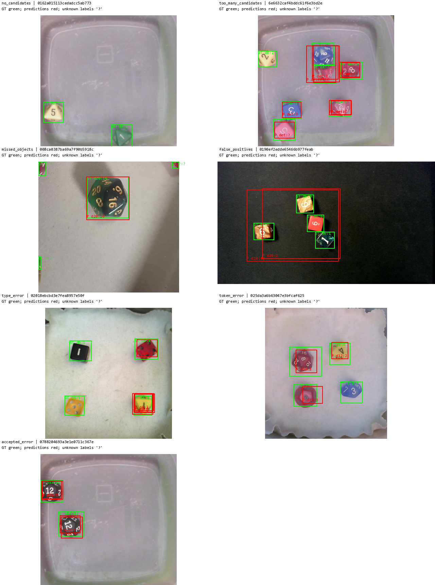

# E2 — avaliação final offline de cenas com 2–8 dados

> **Conclusão técnica:** não recomendo liberar este candidato. Houve reconhecimento completo de 45/1.747 instâncias avaliáveis (2,58%), nenhuma cena completa correta entre 360 avaliáveis e somente 2/12 aceites automáticos corretos. A aprovação ou rejeição formal permanece pendente do usuário.

**Execução:** `e2-v1-20261117`. **Candidato congelado:** `v1-e1-20261117T175200Z`. Nenhum treinamento ou ajuste foi executado.

Conjunto: **518 cenas**, **1941 instâncias**, **1747 referências com tipo e token conhecidos**. Acerto completo de cena é avaliável em **360 cenas**; as demais são excluídas somente dessa métrica.

## Resultados principais — CUDA

| Métrica | Resultado |
|---|---:|
| AP50:95 do detector, avaliador Ultralytics | 0.087814 |
| AP50 / AP75 | 0.246752 / 0.025876 |
| Precisão espacial, filtro 0,25 | 52.54% |
| Recall espacial, filtro 0,25 | 22.93% |
| F1 espacial, filtro 0,25 | 31.92% |
| Recall espacial no limiar 0,95 | 2.37% |
| Tipo correto entre pares retornados avaliáveis | 59.44% |
| Token correto entre pares retornados avaliáveis | 17.18% |
| Valor normalizado correto entre pares retornados avaliáveis | 17.18% |
| Precisão de reconhecimento completo | 5.62% |
| Recall de reconhecimento completo | 2.58% |
| Cena completamente correta | 0.00% |
| Contagem correta do detector | 10.62% |
| Precisão entre aceitos avaliáveis | 16.67% |
| Cobertura correta automática | 0.11% |
| Cenas que precisam de intervenção manual (inclui erros) | 100.00% |

### Contagens e denominadores

```json
{
  "images": 518,
  "references": 1941,
  "predictions": 847,
  "spatial_tp": 445,
  "spatial_fp": 402,
  "spatial_fn": 1496,
  "high_predictions": 49,
  "high_tp": 46,
  "high_fp": 3,
  "high_fn": 1895,
  "returned_items": 811,
  "joint_references": 1747,
  "accepted": 12,
  "review_items": 799,
  "manual_images": 518,
  "count_exact_images": 55,
  "absolute_count_error": 1298,
  "exact_eligible_images": 360,
  "technical_limit_images": 0,
  "status_needs_review": 335,
  "incompatible_items": 107,
  "recognition_evaluable_predictions": 801,
  "accepted_evaluable": 12,
  "paired_type_support": 429,
  "paired_type_correct": 255,
  "paired_value_support": 419,
  "paired_token_correct": 72,
  "paired_value_correct": 72,
  "paired_joint_support": 419,
  "joint_correct": 45,
  "joint_normalized_correct": 45,
  "exact_correct_images": 0,
  "status_no_candidates": 179,
  "status_too_many_candidates": 4,
  "accepted_correct": 2
}
```

O pareamento operacional maximiza o número de pares com IoU ≥ 0,50 e, entre eles, a soma de IoU; o desempate é determinístico e independe de tipos e valores preditos. Os aceites são pareados separadamente contra todas as referências. Aceitos pareados a rótulos incompletos não entram na precisão entre aceitos; falsos positivos aceitos entram como erro.

Os limiares fixos são detecção ≥ 0,95, tipo ≥ 0,80 e valor ≥ 0,80, com comparação sem arredondamento. Pares tipo/token incompatíveis exigem revisão. A confiança não foi calibrada.

O estado `ok` só indica aceite dos itens retornados: ele pode coexistir com dados omitidos. Por isso a taxa de intervenção não substitui o recall ou a cobertura automática correta.

A AP foi medida em passagem separada pelo avaliador Ultralytics 8.4.173, com filtro 0,001 e máximo técnico 300. A cascata operacional usa filtro 0,25 e máximo técnico 64. Não se chama o pareamento operacional de avaliador COCO. Quando há mais de oito candidatos, não há retorno parcial de itens; candidatos internos permanecem no diagnóstico espacial.

## Resultados por quantidade de dados — CUDA

| Dados na cena | Cenas | Recall espacial | Recall completo | Cena exata | Cobertura automática correta |
|---|---:|---:|---:|---:|---:|
| 2 | 142 | 33.10% | 4.35% | 0.00% | 0.40% |
| 3 | 95 | 17.54% | 0.85% | 0.00% | 0.00% |
| 4 | 180 | 28.89% | 3.57% | 0.00% | 0.15% |
| 5 | 28 | 15.00% | 0.76% | 0.00% | 0.00% |
| 6 | 27 | 16.67% | 2.04% | 0.00% | 0.00% |
| 7 | 18 | 12.70% | 2.61% | 0.00% | 0.00% |
| 8 | 28 | 12.95% | 0.52% | 0.00% | 0.00% |

## Resultados por tipo de referência — CUDA

| Tipo | Referências | Detectadas | Tipo correto / pares avaliáveis | Token correto / pares avaliáveis | Reconhecimento completo / referências conjuntas |
|---|---:|---:|---:|---:|---:|
| d10 | 319 | 70 | 33/67 | 16/67 | 10/313 |
| d10_tens | 99 | 2 | 0/1 | 0/1 | 0/98 |
| d12 | 236 | 72 | 34/68 | 9/67 | 7/226 |
| d20 | 424 | 193 | 153/188 | 18/183 | 18/412 |
| d4 | 143 | 2 | 1/2 | 1/1 | 0/20 |
| d6 | 400 | 63 | 32/61 | 17/59 | 10/386 |
| d8 | 306 | 43 | 2/42 | 11/41 | 0/292 |
| unknown | 14 | 0 | 0/0 | 0/0 | 0/0 |

Resultados por modalidade, origem, contagem e tipo×modalidade estão nos JSONs de métricas, com suportes. Macro-F1 é condicional aos pares classificados e só inclui classes com referência avaliável, listadas junto dos suportes. Modalidade desconhecida permanece desconhecida. Negativas não pertencem ao conjunto E2 desta execução.

## Tempos de inferência offline

| Dispositivo | Cenas | Média | p50 | p95 | p99 | Tempo total da execução do dispositivo |
|---|---:|---:|---:|---:|---:|---:|
| cuda | 518 | 67.69 ms | 55.05 ms | 164.77 ms | 213.91 ms | 61.13 s |
| cpu | 518 | 126.54 ms | 108.19 ms | 259.22 ms | 336.84 ms | 68.38 s |

Precisão FP32, concorrência 1, uma imagem por chamada, lotes de até oito recortes. Três aquecimentos usam uma imagem E1; cold start e carregamento são registrados à parte. Os percentis usam interpolação linear sobre as cenas diferentes, não repetições da mesma cena. O tempo por imagem inclui decodificação e cascata, mas exclui pareamento/métricas; é sincronizado em CUDA. A duração total do dispositivo inclui carregamento, aquecimento, métricas e, em CUDA, AP adicional. Não são latências HTTP, MinIO, cliente ou medidas de carga concorrente.

Os percentis gerais incluem as respostas sem candidatos e os erros de excesso; esses caminhos podem ser mais rápidos. Os tempos também estão separados por estado em `latency-by-status.csv`.

## Limites e estado do projeto

Esta execução atende à avaliação offline E2 solicitada diretamente pelo usuário. A composição local necessária foi implementada; o serviço BentoML/MinIO da Etapa 5 não foi concluído ou aprovado por esta avaliação. Nenhum resultado de E2 foi usado para alterar pesos, limiares, pré-processamento ou hiperparâmetros.

Os grupos e as limitações de cobertura aprovadas permanecem; não se demonstra generalização para coleções ou dados físicos inéditos. Os 17.450 arquivos do dataset foram conferidos antes e depois; hashes dos pesos também foram preservados. Nenhum teste automatizado foi criado ou executado. A CPU foi exercitada em processo com CUDA ocultada, usando a wheel CUDA; não se declara validação de wheel CPU-only ou de serviço em produção. AP adicional em CPU não foi executada.

## Artefatos

- [Protocolo congelado e definições](../../../evidence/evaluation/e2-v1-20261117/protocol.json).
- [Métricas CUDA](../../../evidence/evaluation/e2-v1-20261117/cuda/metrics.json) e [métricas CPU](../../../evidence/evaluation/e2-v1-20261117/cpu/metrics.json).
- [AP do detector](../../../evidence/evaluation/e2-v1-20261117/cuda/detector-ap.json).
- [Tempos por contagem e dispositivo](../../../evidence/evaluation/e2-v1-20261117/latency-by-count.csv).
- [Predições completas CUDA](../../../evidence/evaluation/e2-v1-20261117/cuda/predictions.jsonl) e [CPU](../../../evidence/evaluation/e2-v1-20261117/cpu/predictions.jsonl).
- [Exemplos de erros e critérios de seleção](../../../evidence/evaluation/e2-v1-20261117/error-examples.json).



## Próximo marco

Apresentar estes resultados ao usuário para aprovação ou rejeição explícita do candidato. Nenhum modelo foi promovido; a entrega do serviço continua dependendo das etapas de integração e operação previstas no plano.

## Conferência independente final

As métricas, os rótulos, os estados e as decisões de aceite coincidiram entre CPU e CUDA. Pequenas diferenças numéricas foram observadas nas caixas (máximo 0,000366 px) e na confiança de detecção (máximo 0,00000566), sem alterar as decisões. Os exemplos foram inspecionados visualmente como evidência de omissões, caixas que englobam múltiplos dados e confusões de tipo/valor; nenhuma anotação foi alterada.
